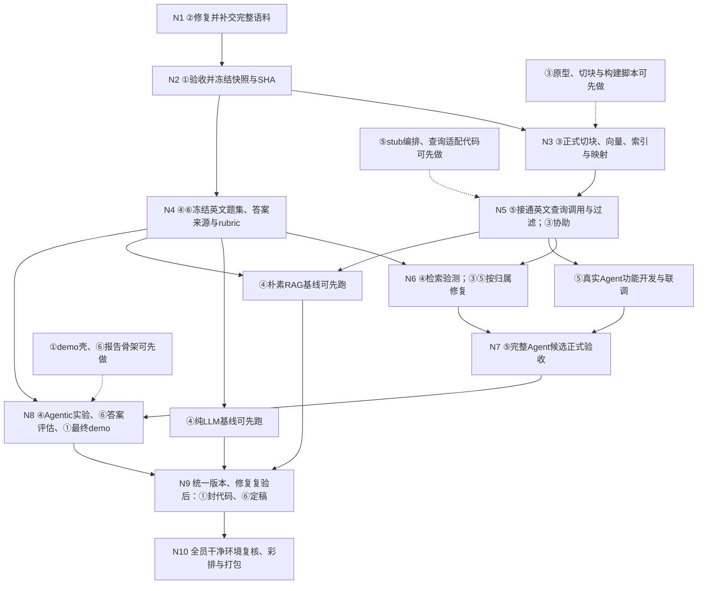
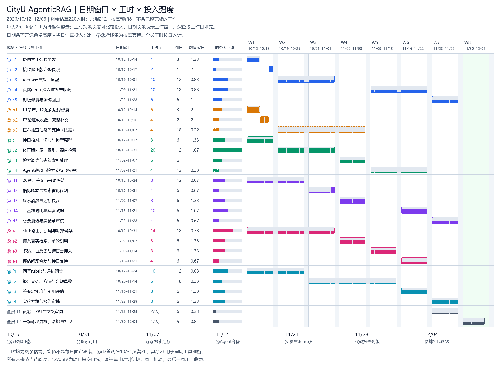
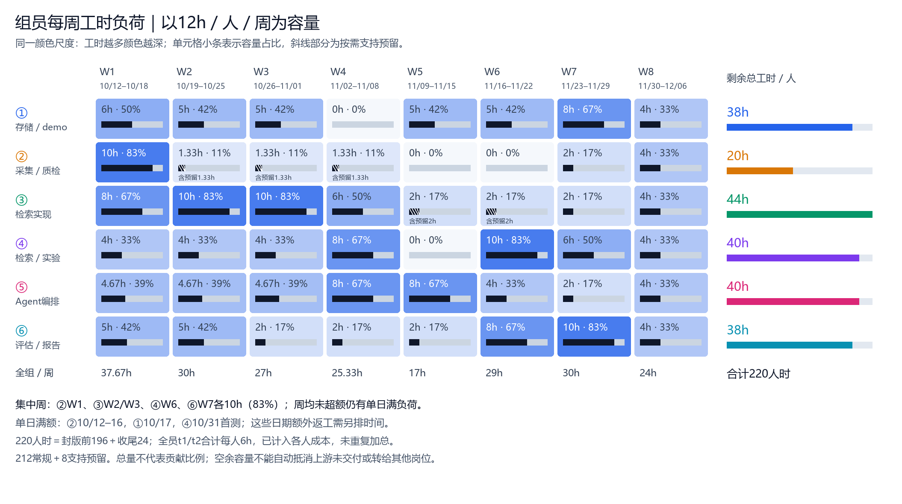
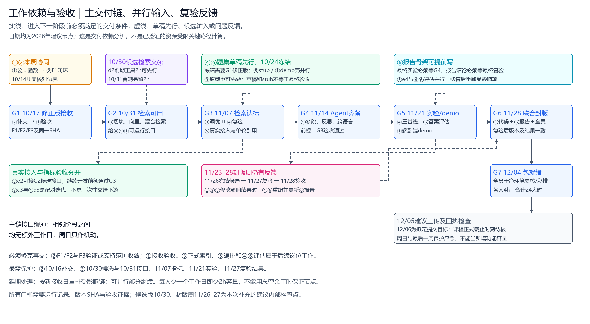
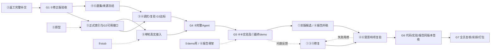
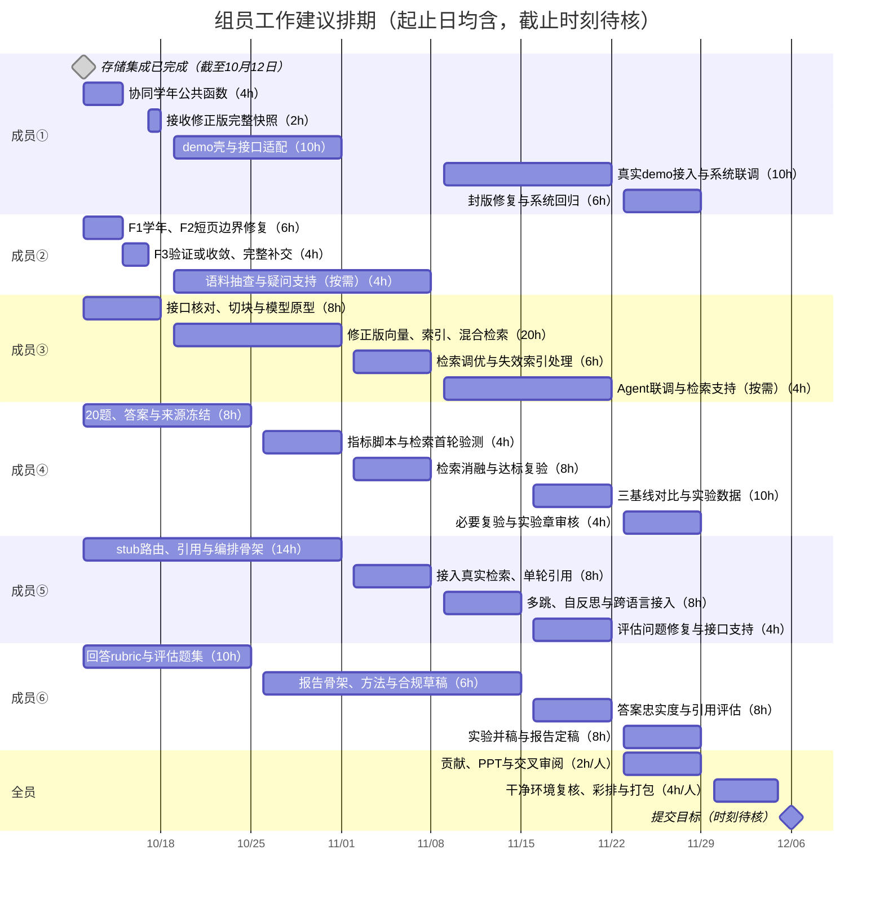

# 组员排期与甘特图

更新：**2026-10-12（周一）**。当前工作状态来自本轮①②交接；未来日期均为**建议安排，待组员确认可投入时间**。本文件是当前排期入口，替代旧计划中的W1–W9和“最早／最迟极限”推算。

**提交目标暂沿用2026-12-06（周日）；课程正式截止日期及具体时刻待核。内部封版目标为2026-11-28（周六），12月4日交付包就绪。** 本地选题说明写“拟定提交日期”，TeamForming.docx未给提交截止；不能把旧计划中的23:59当作课程已确认要求。

## 岗位需求节点与并行工作（2026-10-21更新）

本节按最新约定解释任务依赖：**当前全英文；③负责切块、向量、索引和加载资料，⑤在Agent应用端接查询编码／调用与条件映射，③协助基础适配，④在适配可运行后验测。** 10月12日的图表、工时和日历保留为估算基线；若与本节的岗位边界、前后顺序冲突，以本节为当前说明。此处未取得新的进度证据，10/16补交、10/17验收等已过日期仅是原目标，不能据此认定完成；未重新计算截至10/21的剩余工时。

“可以不等”指已有接口／样例足以完成该部分的规则、代码或草稿；“必须等”指正式运行或最终验收需要上游真实交付。**没有岗位可以在完全不对齐接口的情况下独自完成全部验收。** 下图实线为正式交付条件，虚线为可并行准备或原型输入。

### 正式交付链：看清前置输入与后续接收人

N6检索尚在调优时，⑤可以继续真实Agent功能开发；N7最终验收需要检索达标及功能候选都齐。④不必等完整Agent才跑纯LLM和朴素RAG基线，但三者正式对比必须统一题集、配置和版本。图中先跑的结果如被后续版本变更影响，N9前须重跑。

### 六个岗位：哪些自己先完成，哪些等到节点再做

| 岗位 | 可不等其他人成果、先独立完成的部分 | 必须等什么才能完成正式工作 | 完成后交给谁／启动什么 |
|---|---|---|---|
| **① 存储／集成／demo** | 公共学年函数及边界用例；快照接收／验收脚本；用mock搭demo界面、日志和错误展示 | 接收正式快照等②N1；真实demo接入等⑤N5查询通路，最终端到端演示等N7；封版等④⑥N8及受影响项复验 | N2快照及SHA交③④⑥；demo交全组评估／彩排；封版代码交⑥与全员 |
| **② 采集／质检** | F1/F2修复、F3最小验证或支持范围收敛；完整快照、审计、质检及自测证据 | 不等③④⑤开始返工；若F1涉及公共函数，完成闭环前与①对齐规则及用例。正式接收结论由①给出 | N1完整包交①；验收通过进入N2，③才能用它建正式索引。不能只交差异片段 |
| **③ 切块／向量／索引** | 用当前样例写切块和构建脚本、模型运行验证、ID映射／保存加载、失效重建逻辑；可完成并自测原型代码 | 正式数据构建等①N2；最终参数选择等④N6失败题反馈；③提供模型／映射资料协助⑤N5。不等完整Agent才做索引 | N3索引、chunk映射、模型版本、归一化／切块配置、元数据取值与加载命令交⑤；同版本候选交④ |
| **④ 检索／实验评估** | 英文20题草稿与评分规则、指标／消融脚本、实验配置、纯LLM调用脚本；数据冻结后可先跑纯LLM基线 | 答案和来源最终冻结等①N2；真实检索首测／朴素RAG等③N3＋⑤N5；Agentic实验等N7；最终对比等三基线版本一致 | 检索失败明细在N6交③⑤；N8实验表／配置／运行记录交⑥和①；变更后复验支持N9 |
| **⑤ Agent／应用查询** | 按已知Hit／接口做stub；英文query编码与调用适配代码、topic／column别名映射；路由、多跳／反思编排和空结果处理的mock测试 | 真实接入等③N3的索引、模型／归一化配置、映射和加载方式；如③未提供字段值先用约定值，最终核对实际取值。N7正式验收等N6检索达标 | N5可调用英文检索交④及①；N7完整Agent与运行配置交④⑥①。当前不为中文翻译或跨语言等待 |
| **⑥ 回答评估／报告** | rubric草稿、报告结构、研究背景／方法框架／合规模板、评估脚本、本人贡献与PPT草稿 | 与④题集／标准答案对齐并在N4冻结；真实答案评分等⑤N7；最终结论等④N8实验及N9复验后的固定版本 | 评分rubric交④⑤；答案缺陷交⑤、检索归因交③④；定稿报告交①及全员 |

“独立完成”不代表接口可以自行变更。①②公共函数、③⑤数据格式、④⑥题集和rubric至少需要一次对齐；之后可以各自实现并用mock自测。PPT与报告的框架可先写，最终截图、数字和结论仍要等真实结果。

### 需求节点：前面交什么，后面才能干什么

| 节点／主责 | 前置输入／向谁要 | 通过条件／交付内容 | 后续接收人及解锁工作 |
|---|---|---|---|
| **N0 接口对齐（持续）** | 已有分工、Hit及数据库约定；①②、③⑤、④⑥分别确认 | 公共函数和用例；字段／ID／模型编码约定；英文题集及rubric口径。可用现有约定开工，变更需通知 | 所有人可先做脚本、stub和草稿；不等待最终数据 |
| **N1 语料补交／②** | 现有返工问题及①公共函数规则 | F1/F2闭环；F3验证或支持范围明确；完整JSONL、质检／审计／自测、SHA及条数说明 | ①开始正式接收验收。③可继续原型，尚不能称正式数据已验收 |
| **N2 快照验收／①** | N1完整包 | 独立接收／回归记录，确认可用快照SHA、活动文档及语义问题处置；失败则退回② | ③正式构建；④⑥冻结题目／答案来源；同一SHA贯穿后续 |
| **N3 索引交付／③** | N2；已自测的切块／编码／构建代码 | 索引＋chunks／向量映射＋模型revision／编码／归一化配置＋元数据取值＋加载／重建说明；可重载并回溯来源，处理失效项 | ⑤真实query适配；④准备验测。同一个可用模型和索引维度必须匹配 |
| **N4 题集与rubric／④⑥** | N2及④⑥各自草稿 | 英文题目、标准答案证据、来源、命中定义和回答评分rubric冻结；开发探针与验收题分开标识 | ④可先跑纯LLM；N5后跑检索及朴素RAG；N7后做统一Agentic评估 |
| **N5 英文查询通路／⑤、③协助** | N3真实索引及配置；⑤可提前写好的适配代码 | 英文输入→正确编码／归一化→候选过滤／检索→Hit完整来源；元数据别名映射、空结果和故障行为明确。最小query通路即可，不必等完整多跳Agent | ④检索首测及朴素RAG；①接真实demo；⑤开发真实Agent功能 |
| **N6 检索验测／④，③⑤修复** | N4题集＋N5查询通路＋固定N2/N3版本 | 既定20题top-5命中≥70%及失败明细；切块／索引问题回③，查询映射／适配问题回⑤。修后复测 | 支持N7完整Agent正式验收。⑤功能开发可在达标前并行，不把迭代误画成整段串行 |
| **N7 Agent候选验收／⑤** | N5；可先开发的编排代码；最终验收结合N6 | 当前英文范围内的完整功能候选、引用和失败路径、统一运行配置；多跳／反思等按既有必需范围交付 | ④Agentic基线；⑥真实答案评分；①最终端到端demo |
| **N8 结果齐备／①④⑥** | N7＋N4；④前面已跑的两条基线 | ④三基线／消融与配置，⑥忠实度／引用评估，①demo运行证据；发现阻塞按归属回修 | ①封版候选；⑥报告并稿；全员审阅可开始 |
| **N9 联合封版／①⑥、全员复核** | N8及对应修复版本；④⑥受影响项复验 | 代码、语料SHA、索引构建、题集、实验结果和报告结论一致；修复后有复验。失败继续回③⑤等责任人，不能带旧结果封版 | 全员使用固定包做N10；⑥完成最终结论、图表及PPT数字 |
| **N10 提交准备／全员** | N9固定包；各人已准备的PPT与贡献草稿 | 干净环境复核、彩排、完整打包、提交方式／人员和回执核验 | 提交；拟定12/06目标及课程正式截止仍需核准 |

### 防止互等与返工的具体约定

1. **⑤不等完整Agent才给④可调用检索。** 先做最小英文查询适配（N5），让④检索评测与⑤高级编排并行。否则④等⑤、⑤等④指标通过会形成互等。
2. **③不等⑤的业务查询逻辑才交索引。** N3交清模型／归一化配置、映射与加载资料，⑤即可接入；③负责解决基础索引问题。
3. **④不等所有Agent功能完成才开始评估。** 纯LLM基线在N4后先跑；朴素RAG在N5后先跑；只有Agentic最终基线依赖N7。正式三者比较仍需版本一致。
4. **⑥不等最终实验才开始写报告。** 背景、方法框架、rubric和合规先做；结果、结论、最终截图留到N8/N9。
5. **①不等⑤才开始demo，也不把mock演示当真实验收。** 壳先做，N5后接查询，N7后验完整系统，N9后固定演示包。
6. **②返工不转给下游。** ③索引或⑤应用查询逻辑不能替代F1/F2与F3验证的正式闭环；上游失败要有问题明细和新版本，不能让下游猜测修复。

本节依据10/17技术反馈及已读交接材料，不代表课程增加新评分项；N编号是需求节点编号，不表示顺序中每个人必须整段等待。按接口分阶段交付即可并行。

## 纠正了什么

1. 排期基准改为10月12日。距12月6日相差55天；含起止日为56天，恰好8个自然周。旧计划从9月29日起算，与当前状态不一致；9月29日至12月6日相差68天，也不能精确称为9.5周。
2. ①已完成存储集成，②已完成主要采集，不再把建表和原始采集列为未来重做。②仍须闭环F1/F2及F3验证；③原型可并行，正式索引须使用已验收修正版。
3. 统一原文分工表与后段v2调整的冲突：本排期沿用后段调整，**①负责demo集成；⑥负责回答评估与报告统稿；PPT由全员各交自己的部分**。③负责向量索引，①负责数据库模型及SQL索引。此责任安排沿用旧计划调整，尚未取得全组新确认。
4. ④⑥从本周准备题集与rubric，⑤按接口开发stub，⑥提前搭报告骨架。最终三基线及回答评估安排在完整Agent之后，最终报告安排在实验结果之后。
5. 11/30–12/06保护为收尾窗口，内有复核、彩排及提交准备；不是整周空闲。“总工时低／AI提效”不能保证依赖链按时完成，取消旧版确定性的极限工期承诺。

## 甘特图

横轴为自然日，起止日均含。图左侧增加**估算工时、工作日数、平均h/日及统一0–20h工时条**；日期条浅底表示窗口，下方深色带逐工作日填充，高度表示当日估算投入占2h容量的比例（周日不填；d2末日首测投入更高）。颜色标识成员；虚线表示②③按需支持预留；灰底周日为机动。全员t1/t2的图示工时为每人投入，已分别计入六人总工时。平均值不是每天固定工时，所有未来工作仍待实施及验收。

## 工时负荷与集中程度

**剩余估算220人时＝212常规投入＋8按需支持预留；其中11/28封版前196人时、收尾24人时。** ②b3、③c4各4h为支持预留，未发生时不算实际已用工时。全员t1为2h/人、t2为4h/人，总计36人时，已包含在各人合计中。数字不包含①②已完成的历史投入，不能据此衡量总贡献。

| 成员 | W1 | W2 | W3 | W4 | W5 | W6 | W7 | W8 | 合计h | 按需预留h |
|---|---:|---:|---:|---:|---:|---:|---:|---:|---:|---:|
| ① | 6 | 5 | 5 | 0 | 5 | 5 | 8 | 4 | 38 | 0 |
| ② | 10 | 1.33 | 1.33 | 1.33 | 0 | 0 | 2 | 4 | 20 | 4 |
| ③ | 8 | 10 | 10 | 6 | 2 | 2 | 2 | 4 | 44 | 4 |
| ④ | 4 | 4 | 4 | 8 | 0 | 10 | 6 | 4 | 40 | 0 |
| ⑤ | 4.67 | 4.67 | 4.67 | 8 | 8 | 4 | 2 | 4 | 40 | 0 |
| ⑥ | 5 | 5 | 2 | 2 | 2 | 8 | 10 | 4 | 38 | 0 |
| **全组** | 37.67 | 30 | 27 | 25.33 | 17 | 29 | 30 | 24 | **220** | **8** |

W1–W8日期见下方每周表。表中小数取两位，合计以未舍入数计算；②4h支持均分三周，四舍五入后单元格相加会有0.01h差异。图中容量百分比按12h/人/周计算。

- **相对集中周**：②W1、③W2/W3、④W6、⑥W7均为10h/12h（83%），剩余2h需保护给返工与沟通；这不是已超负荷。
- **单日满负荷**：②10/12–16每日2h；①10/17验收2h；④10/31首测2h。周总量尚有余量也不能在这些日期无条件追加任务。
- **③的20h索引任务**覆盖12个工作日，平均1.67h/日；⑤14h的stub任务跨18个工作日，平均0.78h/日。长条较长不代表投入更多，应看h与强度。
- **④d2的4h明确拆分**：10/26–30工具准备合计2h（估算均分0.4h/日）；10/31真实候选首测2h。故需要③10/30候选输入；候选未交则首测延期，不能把工具完成当检索测试完成。

## 任务工时与输入条件

下表为全部27个剩余任务的估算与交付条件。平均值＝工时÷周一至周六工作日；d2采用上文细分，其余按窗口均分仅供负荷估算。“须G1/G3”等指验收通过；同窗口内的候选、冻结、复验及反馈关系不能简化成所有任务串行。

| ID／成员 | 剩余任务 | 估算h | 工作日 | 平均h/日 | 输入条件／关系 |
|---|---|---:|---:|---:|---|
| a1／① | 协同学年公共函数 | 4 | 3 | 1.33 | 可独立先行 |
| a2／① | 接收修正版完整快照 | 2 | 1 | 2 | b2 |
| a3／① | demo壳与接口适配 | 10 | 12 | 0.83 | 可独立先行 |
| a4／① | 真实demo接入与系统联调 | 10 | 12 | 0.83 | e2＋a3可开始；最终demo需e3/G4且关联G5 |
| a5／① | 封版修复与系统回归 | 6 | 6 | 1 | a4/e3/d4/f3；候选变更须反馈d5/f4 |
| b1／② | F1学年、F2短页边界修复 | 6 | 3 | 2 | 可与a1并行；F1闭环前须共同核对公共函数 |
| b2／② | F3验证或收敛、完整补交 | 4 | 2 | 2 | b1完成；a1边界已对齐；补齐F3及完整快照 |
| b3／② | 语料抽查与疑问支持（按需） | 4 | 18 | 0.22 | a2；按需预留 |
| c1／③ | 接口核对、切块与模型原型 | 8 | 6 | 1.33 | 可独立先行 |
| c2／③ | 修正版向量、索引、混合检索 | 20 | 12 | 1.67 | a2＋c1；10/30候选给④、10/31正式可用版 |
| c3／③ | 检索调优与失效索引处理 | 6 | 6 | 1 | c2、d1、d2；与d3配对迭代、共同过G3 |
| c4／③ | Agent联调与检索支持（按需） | 4 | 12 | 0.33 | c3；按需预留 |
| d1／④ | 20题、答案与来源冻结 | 8 | 12 | 0.67 | 草稿先行；最终题目/答案/来源冻结须G1 |
| d2／④ | 指标脚本与检索首轮验测 | 4 | 6 | 0.67 | d1；工具2h先行，首测2h须③10/30可运行候选版 |
| d3／④ | 检索消融与达标复验 | 8 | 6 | 1.33 | c2＋d2；与c3配对迭代、共同过G3 |
| d4／④ | 三基线对比与实验数据 | 10 | 6 | 1.67 | e3＋d3；e4并行修复，变更后重跑相关项 |
| d5／④ | 必要复验与实验章审核 | 4 | 6 | 0.67 | d4初始结果；a5变更影响指标时必须复验 |
| e1／⑤ | stub路由、引用与编排骨架 | 14 | 18 | 0.78 | 可独立先行 |
| e2／⑤ | 接入真实检索、单轮引用 | 8 | 6 | 1.33 | c2＋e1；真实接入可先于G3最终达标 |
| e3／⑤ | 多跳、自反思与跨语言接入 | 8 | 6 | 1.33 | e2且G3通过；功能最终版本供d4/f3评估 |
| e4／⑤ | 评估问题修复与接口支持 | 4 | 6 | 0.67 | e3；与d4/f3评估并行，问题修复后回传复验 |
| f1／⑥ | 回答rubric与评估题集 | 10 | 12 | 0.83 | rubric草稿先行；最终题集冻结须G1，并与d1对应 |
| f2／⑥ | 报告骨架、方法与合规草稿 | 6 | 18 | 0.33 | f1 |
| f3／⑥ | 答案忠实度与引用评估 | 8 | 6 | 1.33 | e3＋f1；e4并行修复，变更后重跑相关项 |
| f4／⑥ | 实验并稿与报告定稿 | 8 | 6 | 1.33 | d4/f3/f2可并稿；最终结论须d5与最终版本复验 |
| t1／全员 | 贡献、PPT与交叉审阅 | 2/人 | 6 | 0.33 | d4/f3可起草；审阅与d5/f4迭代至G6 |
| t2／全员 | 干净环境复核、彩排与打包 | 4/人 | 5 | 0.8 | a5/f4/t1通过G6；每人4h，共24人时 |

## 组员安排

| 成员 | 已知状态（截至10月12日） | 计划工作窗口与交付 |
|---|---|---|
| **① 存储／集成／demo** | 存储接收集成已完成 | 10/12–14协同公共学年函数；10/17接收②；10/19–31搭demo壳；11/09–21接真实Agent并联调；11/23–28封版回归 |
| **② 采集／质检** | 主要采集已完成，F1/F2/F3待闭环 | 10/12–14修F1/F2；10/15–16补F3验证或收敛支持范围并回传完整快照；10/19–11/07按需支持语料抽查。③索引与⑤编排不属于②返工 |
| **③ 检索实现** | 接收要求已明确，未提供完成证据 | 10/12–17核对接口、切块与模型原型；10/19–31用修正版构建向量及混合检索；11/02–07调优和失效索引处理；11/09–21按需联调 |
| **④ 检索／实验评估** | 本轮未提供进度证据 | 10/12–24准备并冻结20题及答案／来源（修正版接收前仅作草稿）；10/26–31指标脚本与首测；11/02–07消融和达标复验；11/16–21三基线；11/23–28必要复验、实验章审核 |
| **⑤ Agent编排** | 现有生成雏形；本轮未提供新增成果证据 | 10/12–31按既定接口做stub路由／引用／编排；11/02–07接真实检索；11/09–14完成多跳、自反思、跨语言；11/16–21支持实验与修复 |
| **⑥ 回答评估／报告** | 本轮未提供进度证据 | 10/12–24确定rubric并复用④题集补回答评估案例；10/26–11/14报告骨架、方法及合规草稿；11/16–21答案评估；11/23–28统稿定稿 |
| **全员** | 未来计划，不代表已实施 | 11/23–28各自贡献、PPT与交叉审阅；11/30–12/04干净环境复核、彩排和打包；12/05建议完成提交核验，12/06保留应急余量 |

## 接收节点与通过条件

| 节点 | 日期／星期 | 主责与交接 | 通过条件 |
|---|---|---|---|
| G1 修正版接收 | **10月17日（六）** | ②10月16日（五）补交 → ①验收 → ③④⑥使用 | F1/F2边界修复；F3有真实验证或收敛默认／支持范围；完整快照、新SHA、质检与回归齐备。接收失败则状态保持未验收 |
| G2 检索接口可用 | **10月31日（六）** | ③ → ④⑤① | 修正版切块、embedding、索引与混合检索可运行；Hit含来源；索引绑定同一语料版本；③10/30先交可运行候选供④10/31首测。此节点不等于指标已达标 |
| G3 检索验收／单轮接入 | **11月7日（六）** | ③④检索验证；⑤接入 | ④用10月24日冻结的20题验证top-5命中率≥70%；⑤真实检索返回可溯源引用；首轮消融结果留档 |
| G4 Agent功能齐备 | **11月14日（六）** | ⑤ → ④⑥① | 路由、多跳、自反思、跨语言与引用可演示；失败／空检索路径明确；具备运行三基线的统一配置 |
| G5 实验与demo齐备 | **11月21日（六）** | ④⑥交数据；①交demo | 三基线与消融有可复现结果，忠实度及引用评估齐备；demo可端到端运行。未达目标须列问题并于封版前修复、复验 |
| G6 内部封版 | **11月28日（六）** | ①代码、⑥报告、全员复核 | 11/26候选冻结、11/27复验结果提交，11/28签收；阻塞问题闭环，最终代码、语料、索引、实验、报告版本一致。若复验失败即重排；11/29（日）为机动 |
| G7 提交包就绪 | **12月4日（五）** | 全员 | 干净环境复核、完整彩排、贡献声明、代码／报告／PPT及演示材料齐备；提交方式已确认 |
| 项目提交目标 | **12月6日（日）** | 全员／最终提交人待确认 | 以课程正式通知核准日期与时刻；建议12月5日前完成上传及回执检查，不把12月6日当开发日 |

所有节点都需有证据才能通过；计划日期不是验收结论。④检索20题与⑥回答评估尽量复用同一题目／来源，并在10/24冻结范围与评分方法，避免两套题集互不对应。原型可以使用当前159条语料；正式实验与封版须固定同一修正版SHA、索引、模型和配置。

## 每周安排

| 周次 | 明确日期（周一至周日） | 当周重点与截止 |
|---|---|---|
| W1 | 10/12–10/18 | ②10/16补交、①10/17验收；③原型，④⑥题集草稿，⑤stub并行 |
| W2 | 10/19–10/25 | ③正式索引开发；④⑥10/24冻结题集与rubric；①demo壳 |
| W3 | 10/26–11/01 | ③10/31交可运行检索；③10/30给④候选，④10/31首测；⑤stub完成，⑥报告骨架 |
| W4 | 11/02–11/08 | ③④11/07检索达标及消融；⑤11/07真实检索单轮引用可用 |
| W5 | 11/09–11/15 | ⑤11/14交完整Agent；①demo接入，③④⑥准备最终实验 |
| W6 | 11/16–11/22 | ④三基线、⑥回答评估、①demo于11/21齐备 |
| W7 | 11/23–11/29 | 必要修复与复验；11/26候选冻结、11/27复验、11/28代码报告签收；全员PPT／审阅；11/29机动 |
| W8 | 11/30–12/06 | 复核、彩排、打包，12/04就绪；提交及应急，禁止新增功能 |

## 各成员分时段工作清单

下表按时间顺序列出每位成员在每个窗口可做的事；强度为估算均值，不是每日固定承诺。全员任务t1/t2按每人计，已计入各人合计。空闲窗口不等于无事可做，可用于提前准备下游或支持他人，但不能用来承诺压缩上游工期。

### ①
| 时段 | 工作 | 工时h | 强度h/日 | 说明 |
|---|---|---:|---:|---|
| 10/12–10/14 | a1 协同学年公共函数 | 4 | 1.33 | 与②b1并行协同；F1闭环前共同核对公共函数 |
| 10/17–10/17 | a2 接收修正版完整快照 | 2 | 2.00 | 验收②修正版快照；当日2h已满额 |
| 10/19–10/31 | a3 demo壳与接口适配 | 10 | 0.83 | 不依赖②，可与③c2并行 |
| 11/01–11/08 | 无排期任务 | 0 | 0 | 机动：可提前熟悉⑤接口、准备联调环境；支持③④检索验收问题排查 |
| 11/09–11/21 | a4 真实demo接入与系统联调 | 10 | 0.83 | e2后可开始接入；最终验收须e3/G4 |
| 11/23–11/28 | a5 封版修复与系统回归 | 6 | 1.00 | 含11/26候选冻结、11/27复验、11/28签收 |
| 11/23–11/28 | t1 贡献、PPT与交叉审阅 | 2/人 | 0.33 | 全员共同任务 |
| 11/30–12/04 | t2 干净环境复核、彩排与打包 | 4/人 | 0.80 | 全员共同任务 |

### ②
| 时段 | 工作 | 工时h | 强度h/日 | 说明 |
|---|---|---:|---:|---|
| 10/12–10/14 | b1 F1学年、F2短页边界修复 | 6 | 2.00 | 本周返工主线；连续满额，勿加任务 |
| 10/15–10/16 | b2 F3验证或收敛、完整补交 | 4 | 2.00 | F3补验证或收敛支持范围；产出完整快照交① |
| 10/19–11/07 | b3 语料抽查与疑问支持（按需） | 4 | 0.22 | 按需支持预留4h，未发生不计实际投入 |
| 11/09–11/22 | 无排期任务 | 0 | 0 | 机动：b3支持期已结束；保持可联系，回应下游语料疑问 |
| 11/23–11/28 | t1 贡献、PPT与交叉审阅 | 2/人 | 0.33 | 全员共同任务 |
| 11/30–12/04 | t2 干净环境复核、彩排与打包 | 4/人 | 0.80 | 全员共同任务 |

### ③
| 时段 | 工作 | 工时h | 强度h/日 | 说明 |
|---|---|---:|---:|---|
| 10/12–10/17 | c1 接口核对、切块与模型原型 | 8 | 1.33 | 可在当前159条语料上做原型，不等② |
| 10/19–10/31 | c2 修正版向量、索引、混合检索 | 20 | 1.67 | 10/30给④候选版，10/31交正式可用接口 |
| 11/02–11/07 | c3 检索调优与失效索引处理 | 6 | 1.00 | 与④d3配对迭代，共同过G3 |
| 11/09–11/21 | c4 Agent联调与检索支持（按需） | 4 | 0.33 | 按需支持预留4h |
| 11/23–11/28 | t1 贡献、PPT与交叉审阅 | 2/人 | 0.33 | 全员共同任务 |
| 11/30–12/04 | t2 干净环境复核、彩排与打包 | 4/人 | 0.80 | 全员共同任务 |

### ④
| 时段 | 工作 | 工时h | 强度h/日 | 说明 |
|---|---|---:|---:|---|
| 10/12–10/24 | d1 20题、答案与来源冻结 | 8 | 0.67 | 草稿先行；最终冻结须G1修正版 |
| 10/26–10/31 | d2 指标脚本与检索首轮验测 | 4 | 0.67 | 10/26–30工具2h；10/31真实首测2h |
| 11/02–11/07 | d3 检索消融与达标复验 | 8 | 1.33 | 与③c3配对迭代；消融＋达标复验 |
| 11/08–11/15 | 无排期任务 | 0 | 0 | 机动：预写三基线实验脚本与配置，等G4后直接运行 |
| 11/16–11/21 | d4 三基线对比与实验数据 | 10 | 1.67 | 等G4完整Agent；三基线对比 |
| 11/23–11/28 | d5 必要复验与实验章审核 | 4 | 0.67 | 代码变更影响指标时必须复验 |
| 11/23–11/28 | t1 贡献、PPT与交叉审阅 | 2/人 | 0.33 | 全员共同任务 |
| 11/30–12/04 | t2 干净环境复核、彩排与打包 | 4/人 | 0.80 | 全员共同任务 |

### ⑤
| 时段 | 工作 | 工时h | 强度h/日 | 说明 |
|---|---|---:|---:|---|
| 10/12–10/31 | e1 stub路由、引用与编排骨架 | 14 | 0.78 | 不依赖③正式索引；按既定接口做stub |
| 11/02–11/07 | e2 接入真实检索、单轮引用 | 8 | 1.33 | 接G2候选接口；接入≠检索达标 |
| 11/09–11/14 | e3 多跳、自反思与跨语言接入 | 8 | 1.33 | 须G3通过；产出供④⑥①最终验收 |
| 11/16–11/21 | e4 评估问题修复与接口支持 | 4 | 0.67 | 评估期修复；变更后回传④⑥复验 |
| 11/23–11/28 | t1 贡献、PPT与交叉审阅 | 2/人 | 0.33 | 全员共同任务 |
| 11/30–12/04 | t2 干净环境复核、彩排与打包 | 4/人 | 0.80 | 全员共同任务 |

### ⑥
| 时段 | 工作 | 工时h | 强度h/日 | 说明 |
|---|---|---:|---:|---|
| 10/12–10/24 | f1 回答rubric与评估题集 | 10 | 0.83 | 复用④题集；rubric草稿先行 |
| 10/26–11/14 | f2 报告骨架、方法与合规草稿 | 6 | 0.33 | 报告骨架不等实验；最终结论等复验 |
| 11/16–11/21 | f3 答案忠实度与引用评估 | 8 | 1.33 | 等G4完整Agent；变更后重跑受影响项 |
| 11/23–11/28 | f4 实验并稿与报告定稿 | 8 | 1.33 | 可提前并稿；最终版本须d5复验结果 |
| 11/23–11/28 | t1 贡献、PPT与交叉审阅 | 2/人 | 0.33 | 全员共同任务 |
| 11/30–12/04 | t2 干净环境复核、彩排与打包 | 4/人 | 0.80 | 全员共同任务 |

## 工作依赖与延期影响

**最需保护的交付链**是②返工完整补交→①验收接收→③正式索引与检索→③④指标验收及⑤真实接入→⑤完整Agent→④⑥最终实验与①demo→①代码及⑥报告联合封版→全员复核与打包。它说明上游延期影响范围；目前可用时间与每日具体顺序未确认，**不把它宣称为已计算出的资源受限关键路径**。人时、自然窗口和任务最短工期是不同概念；20h不等于连续20小时完成。

| 关系 | 类型及具体条件 | 上游未交的影响 | 下游可先做什么 |
|---|---|---|---|
| ①a1与②b1/b2 | 协同完成条件；F1边界须对齐公共函数，b1可并行 | ②无法凭单方修改完成F1闭环 | ②其他边界修复、质检用例可先做 |
| ②b2 → ①a2 → ③c2、④d1/⑥f1最终冻结 | 正式快照及SHA硬依赖 | 索引及最终题集来源冻结均推迟 | ③c1、④⑥草稿可用当前159条原型语料；正式实验用修正版 |
| ③c2候选 → ④d2首测 | 部分交付依赖；**10/30给候选，10/31测试**；工具准备独立 | 没候选就没有真实首测，G2/G3验收受影响 | ④编写指标工具；⑤stub、①demo壳继续 |
| ③c3 ⇄ ④d3 → G3 | 并行调优与复验；两人共同通过top-5命中率≥70% | 达标验收推迟，正式Agent及实验输入不就绪 | ⑤e2可先接G2接口，不能把接入当检索已达标 |
| G3/e2 → ⑤e3 → ④d4/⑥f3/①demo最终验收 | 完整功能与达标检索均须通过；a4可从e2阶段开始接入 | 最终三基线、答案评估、端到端演示推迟 | ⑥报告骨架与方法，④实验脚本与配置可先做 |
| ⑤e4与④d4/⑥f3 | 问题反馈与复验；修复变更后重跑受影响题目/基线 | 原有结果可能失效，G5需重新确认 | 保留失败记录与固定配置，避免用不同版本拼结果 |
| ①a5/④d5/⑥f4/全员t1 → G6 | 并稿与修复可并行；最终签收须复验结果一致 | 代码改了而报告未复验时不能封版 | 先并稿/PPT草稿；候选11/26冻结、11/27复验提交、11/28联合签收 |
| G6 → 全员t2 → G7 | 封版通过后复核、彩排和打包 | 提交包与演示受影响 | 可以先列复核项；最终复核必须用封版版本 |

### 接口缓冲与本次补齐的安排

“空档工作日”指上游交付日之后、下游计划开工日之前，未安排的周一至周六日期；不含交付日或开工日，周日不作为固定容量。它是交接日期缓冲，不是CPM总时差。

| 上游交付 → 下游开工 | 空档工作日 | 判断 |
|---|---:|---|
| ②10/16补交 → ①10/17验收 | 0 | ②连续五天满额，验收2h也满额；补交前先做边界自测，新增缺陷须重排 |
| ①10/17接收 → ③10/19正式索引 | 0 | 10/18周日只作机动，不能保证还能返工并重新验收 |
| ③10/30候选 → ④10/31首测 | 0 | 本次补充内部候选检查点，首测留2h；未交候选则首测延期 |
| ③10/31可用 → ③④⑤11/02调优/接入 | 0 | 只有周日机动；索引任务20h占24h容量，4h余量可用于候选修复，不能保证不延期 |
| ③④⑤11/07验收 → ⑤11/09完整Agent | 0 | 真实接入和检索指标必须分别有证据，不能凭日期自动通过 |
| ⑤11/14齐备 → ④⑥11/16最终评估 | 0 | 缺少功能或检索未达标会把三基线、答案评估同时推迟 |
| ①④⑥11/21成果 → 11/23封版周 | 0 | 11/22周日机动；修复与重跑须占各岗位实际余量 |
| 11/26候选 → 11/27复验 → 11/28签收 | 0 | 本次补齐封版周顺序；是窗口内检查点，未新增或压缩工时，具体日分配待组员确认 |
| 11/28封版 → 11/30收尾 | 0 | 11/29可机动；没有额外固定工作日缓冲 |
| 12/04就绪 → 12/06拟定目标 | 1 | 12/05建议用于上传与回执核验；也承担应急，不能视为完整开发日 |

本次保持原27项任务的日期窗口和工时总量，增加③10/30候选与11/26–27封版内检查点，并明确d2的2h工具/2h首测分配。**封版周均摊负荷只能证明总容量可容纳，不能证明内部顺序已落实**：如11/27复验失败，或11/28又改了影响结果的代码，①③⑤必须修复，④⑥重跑，⑥更新结论后才能共同签收；检查点相应顺延，不把未验证版本封版。

### 延期处理与责任边界

- **②当前必返工**：F1学年、F2短页/导航边界须修复；F3补真实最小验证或收敛默认/支持范围。F3当前属于验证不足，不宣称浏览器已经故障。这些闭环和完整快照不能留给③代做。
- **下游各自实施**：③切块/向量/索引/混合检索；④检索指标和实验；⑤Agent编排；⑥回答评估/报告；①demo/接收回归。它们可在各自窗口按依赖推进，不构成②缺交。
- ②10/16未补齐：①不标正式接收；③继续原型，④⑥继续草稿，正式语料/索引/题集冻结按新验收日重排。
- ③10/30未交候选或10/31未交可运行检索：④首测、⑤真实接入和G3以后节点重新评估；stub和指标工具可以继续。空余总工时不能补出缺失输入。
- **资源影响示例**：③c2是20h/12工作日，名义容量24h。少1个可工作日，容量22h、余量2h；少2日仅20h、无返工余量；少3日仅18h、缺2h。此计算假定每天确有2h且无新增工作，不能证明所有上游延期都可吸收；④首测和其他接口仍可能必须顺延。
- 11/21成果未齐或11/27复验失败：停止非评分必需扩展，按实际缺陷重排修复→复验→报告签收；预计11/28不能封版时明确影响，让全组重新确认保护窗口。不得把最后一周自动改成新功能开发期。

可编辑的依赖图以实线表达正式交付门槛；虚线表达可并行输入与修复反馈。虚线不表示可以省略验收。

## 投入假设与待确认事项

沿用旧文档“每人每天2小时、周一至周六6天”的**估算假设**，个人实际可投入时间未重新确认；周日留机动。到11/28为7周，名义上每人84小时；11/30–12/06另有12小时／人用于收尾。容量不能在不同岗位间自动转移。

本排期剔除周日，常规任务及按需支持按窗口均分；d2另外留10/31首测2h，前5日工具准备共2h。计算每人每周和每日总量，最高每日2h、最高每周10h；这是剩余估算与容量检查，不是实测工时，也不保证候选/复验/最终签收顺序已能完成。封版周内部检查点须另行确认日内顺序，失败后必须重排。③④⑤⑥本轮未提供完成证据，已有成果如另行提供，应删除已完成任务并重新计算。

待全组确认：课程正式截止日期／时刻、各人的可投入时间、①demo／⑥评估的责任调整、最终提交人。当前文件无需这些答案也能作为建议计划使用。

## 可编辑图源

以下Mermaid终点按“最后工作日＋1天”表达完整日期范围，任务名附工时标签；条长仍表示日期窗口，详见工时负荷图；今天线关闭，避免查看日改变图意。

