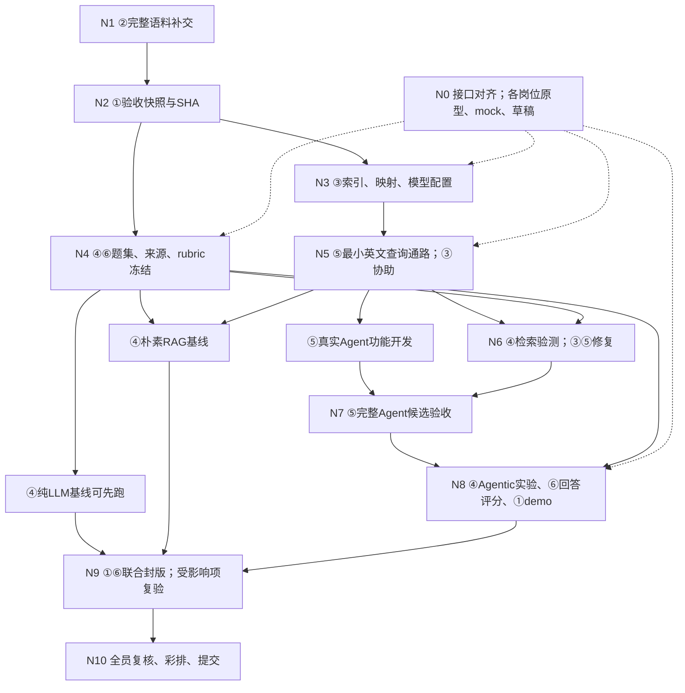

# 协作与需求节点

更新：2026-10-21。这里是全组唯一的当前状态与交接入口；岗位提示词和skill引用本页，不再维护平行报告。①②共同实施，③接收；目前提供采集、快照接收与联网搜索雏形，正式检索及完整RAG仍待交付。

## 节点图

实线表示正式输入依赖；虚线表示可提前准备。图中节点不是完成标记，实际状态见下表。

## 节点状态与交接对象

维护规则：实施者写“候选/待验”；接收者确认输入、版本和证据后才写“通过”。下面没有新的完成证据，默认不通过；已有存储代码及48项离线回归不代表N2语义验收完成。

| 节点／岗位提示词 | 前置输入 | 要交付及通过条件 | 交给谁 | 当前状态／证据 |
|---|---|---|---|---|
| N0／[全岗](岗位提示词.md) | 现有接口与分工 | ①②公共函数、③⑤模型与字段、④⑥题集口径对齐；有变更就更新接口页 | 全员各自开发 | 有既定约定，变更持续核对 |
| N1／[②](岗位提示词.md#member2) | F1/F2/F3与①函数规则 | 完整JSONL、SHA、覆盖及增删摘要；F1/F2回归，F3验证或支持范围收敛 | ①接收 | 待补交与验收 |
| N2／[①](岗位提示词.md#member1) | N1完整交付 | 独立库导入与回归、语义复核；固定可用快照及SHA | ③建库；④⑥冻结题集 | 接收代码已实现；修正版待接收 |
| N3／[③](岗位提示词.md#member3) | N2；已自测构建代码 | 切块、索引及ID映射；模型revision、编码/归一化、字段取值、保存加载与失效处理 | ⑤接查询；④备测 | 待实施／未提供新证据 |
| N4／[④](岗位提示词.md#member4)、[⑥](岗位提示词.md#member6) | N2与题集草稿 | 英文20题、答案来源、命中定义及回答rubric冻结；开发探针与验收题分开 | ④⑤⑥ | 待冻结；草稿可先做 |
| N5／[⑤](岗位提示词.md#member5)，③协助 | N3模型、索引与映射 | 英文query→匹配编码→过滤检索→含来源Hit；空结果与错误可诊断 | ④首测与朴素RAG；①接demo | 待接入；适配代码可先做 |
| N6／[④](岗位提示词.md#member4)，③⑤修复 | N4＋N5，固定数据/索引 | 20题top-5命中≥70%；逐题失败、归因、修复后复验 | ⑤正式验收 | 待评测 |
| N7／[⑤](岗位提示词.md#member5) | N5功能候选＋N6达标 | 英文范围内的路由、多跳/反思、引用和失败路径，统一运行配置 | ①④⑥ | 待实施／验收 |
| N8／[①](岗位提示词.md#member1)、[④](岗位提示词.md#member4)、[⑥](岗位提示词.md#member6) | N4＋N7及提前运行的基线 | 三基线/消融、回答忠实度与引用评分、真实demo；配置与版本可追溯 | ①⑥并稿封版 | 待运行 |
| N9／[①](岗位提示词.md#member1)、[⑥](岗位提示词.md#member6) | N8及修复复验 | 代码提交、语料SHA、索引、题集、实验、报告版本一致 | 全员 | 待封版 |
| N10／全员 | N9固定版本 | 干净环境复核、彩排、贡献与PPT、核准截止和提交方式 | 最终提交人待确认 | 待准备 |

N6调优时⑤可继续开发真实Agent；完整Agent正式验收同时需要功能候选和检索达标。④在N4后先跑纯LLM，N5后先跑朴素RAG；最终对比统一题集和配置，受后续变更影响的结果要重跑。

## 各岗可以先独立完成什么

| 岗位 | 不等上游也可做的部分 | 必须等待的部分 |
|---|---|---|
| ① | 公共函数/边界测试、接收脚本、mock demo壳及日志展示 | 正式语料接收等N1；真实查询等N5；完整demo等N7 |
| ② | F1/F2修复、F3验证、质检和完整快照自测 | F1闭环与①对齐；正式接收结论等① |
| ③ | 样例切块、模型运行验证、构建/映射/加载/失效逻辑 | 正式构建等N2；最终调优需要N6失败明细 |
| ④ | 英文题集草稿、指标与消融脚本、纯LLM脚本 | 来源冻结等N2；真实检索等N5；Agentic实验等N7 |
| ⑤ | stub、query编码适配、字段别名、路由与反思、mock失败测试 | 真实接入等N3；正式完整验收等N6 |
| ⑥ | rubric、报告结构、背景/方法/合规、评分脚本与PPT框架 | 标准与④对齐；评分等N7；最终结论等N8/N9 |

独立推进仍须遵守接口；当前全英文，中文理解/翻译可在⑤应用端后续处理，不作为③当前验收门槛。

## ②当前必须闭环的返工

| 事项 | 已确认问题或证据缺口 | 主责与完成标准 |
|---|---|---|
| F1 学年误标 | `admo/search-0`由时间戳得到`2026-2021`；`en/geo/whats-on/events`由活动日期得到`2025-2028`；排名年份误作整页学年 | ②修`src/corpus.py`，①协同公共函数。只采明确学年上下文，排除日期/时间/排名，不确定留空；三类边界回归并重新导出 |
| F2 短页误删与导航漏判 | 有效`/sro/AboutUs/NSY/contactus.htm`被删；`/admo/explore/news-and-events`导航噪声保留 | ②修解析和采集/导出规则；保留有效联系、开放时间与短表格，纯导航仍排除；加误删/漏判回归并重新导出 |
| F3 浏览器验证缺口 | 默认stealthy，但已有实抓证据来自HTTP，尚不能认定浏览器代码故障 | ②最小验证student-visa默认路径，记录模式/时间/最终URL/正文长度；认证回落若声称支持则补SSO检查。无法验证则调整默认路径或明确未验证范围 |

②已有77→159条、8栏目、13/13配置种子及审计等历史成果保留，不要求重抓全站或维持159条。①已有快照校验、事务导入、旧库升级、来源SHA、active/dirty及引用保护实现保留。F1/F2不能留给③切块或⑤查询来掩盖，③⑤的新实现也不算②返工。

## 用Git交接，文件放哪里

| 内容 | 位置与处理方式 |
|---|---|
| 实现、配置、回归用例 | 仓库`src/`、`config.yaml`、`schema.sql`、`tests/`；按分支提交，审阅对应commit/PR |
| 当前状态、阻塞与接收确认 | 只更新本页对应N/F行；不要再建“成员X交接报告”副本 |
| 完整语料与②采集质量/审计 | 本机`data/corpus.jsonl`、`data/quality_report.json`、`data/crawl_audit.jsonl`；组内传递，不入公开Git |
| ①接收数据库与质量报告 | 本机`data/cityu_faq.db`、`data/quality_documents.json`；独立验收先用`data/acceptance.db`，两类质量报告不互相覆盖 |
| 详细验证证据 | 本机`runs/<节点或提交>/`（忽略）；提交说明只写脱敏摘要、命令、退出码和版本 |
| ③索引/映射、④⑥题集和结果、最终报告 | 待相关岗位实现；建议索引用忽略的`artifacts/`、安全题集用`evals/`，真正落地后更新接口页。当前不伪造这些目录已存在 |

本机路径从仓库根目录计算，Git里不出现个人绝对路径。数据通过组内渠道传递时同时记录文件名、SHA和接收者；Git只交接代码不等于下游已经拿到数据。

每次交付的commit/PR说明写五项即可：`节点与实施人 → 本次变化/commit → 输入数据SHA及模型/索引/题集版本 → 实际验证命令与结果 → 遗留、接收人及下游影响`。接收者补“接受/阻塞、依据及解除条件”，更新本页；共享实施要保留①②等所有贡献人。需要diff或旧日志时从Git历史取，不提交重复拷贝。

状态摘要尚未补齐版本或接收确认时保持待验。日期与工时见[排期与工时](排期与工时.md)，不会自动触发节点通过。
