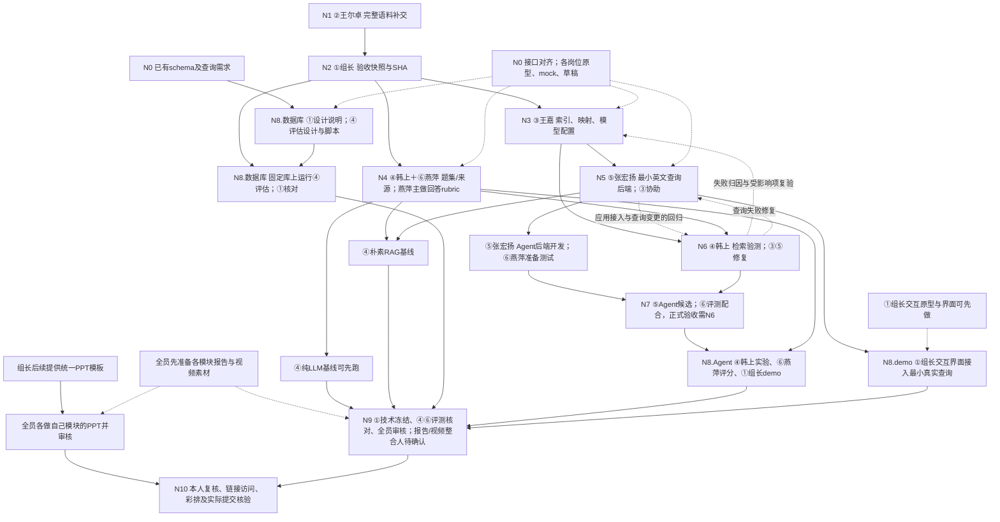

# 协作与需求节点

更新：2026-11-03，Asia/Shanghai。这里是全组唯一的当前状态与交接入口；岗位提示词、排期和skill引用本页。本轮重新取得远端`main=c91e7d4`及取件分支`codex/n5-real-rag-20261101=2373dd1`，确认N5的881-chunk索引与当前159条语料SHA同版。①②采集/存储成果保留；③实现、运行、质量与下游接受继续分开判断，姓名与分工沿用10/25登记。

## 10月31日同版确认与交付范围

组长明确①②沿用采集后未再更新的同一份语料。本轮只读核对159行JSONL与SQLite中159条活动文档：URL集合相同、全部12个交付字段差异为0，数据库记录的来源SHA均等于`2c3f9a2d9dc116062791e8c646ad7e343fd8e22f5a59c91581f84808b0620752`，SQLite完整性检查为`ok`。已有2次导入记录，数据库`chunks=0`；不能以此推断外置FAISS索引是否存在。

**①②版本一致性已确认，可以交付当前开发基线，不再要求重复证明是否同版。** ③实际取件后可按该SHA准备候选构建，⑤继续接口开发，④⑥继续标注准备。③历史158篇声明与本次159行的差异仍由③解释，不能自动把两者当作同一次构建。

本轮未重新验证F1/F2/F3、政策适用性或真实模型性能，也未代下游确认取件；版本一致性与这些验收范围分别记录。`src/corpus_import.py`每次导入和质量检查都固定输出`pending_member2`、`release_ready=false`，故这些值不是人工审核系统的实际状态，不能单独证明②未复核或数据库故障。

组长随后明确授权公开发布当前基线：`data/cityu_faq.db`为脱敏发布副本，`data/corpus.jsonl`保持原始字节及上述SHA，`data/release_manifest.json`记录版本与检查范围。数据库两条导入记录及其JSON报告中的本机路径已替换，重整后完整性及外键检查通过；其他表内容未改变，原始库未修改。模型、索引、私有题集、研究快照及日志不在本次范围。

①②数据文件现在可随Git取得，③无需再等待这两份文件的组内传输；③⑤④实际拉取、加载和接受仍由本人记录。后续运行建议复制到忽略的`data/runtime.db`，不把问答日志回写到公开基线。历史段落中“SHA未核实／发布目录无数据”由本节更新，F项和正式语义接受没有自动关闭。

## 11月3日 CORE20 检索候选结果

重新合并远端`main`后，④侧5道DEV＋20道CORE仍为`draft`。本地使用N5取件分支的881-chunk索引（`index_sha256=2e6b7edc...1129590`）、固定E5 revision `614241f...418b3`和固定rerank revision `1427fd65...d8825`完成真实检索。20道CORE的draft候选结果：E5-only Hit@5=8/20，rerank@20=13/20，rerank@50=17/20，rerank@100=18/20；rerank@50的逐题、延迟和失败原因已保存在本机`runs/retrieval/`。

17/20达到内部70%门槛的数值，但**不登记N6正式通过**：题集尚未完成role4/role6双评与冻结，候选深度50也是在当前draft集上选择，不能当独立泛化证据。剩余失败为`CORE-FEE-002`、`CORE-REG-002`、`CORE-RES-001`。本轮新增`--model-path`、`--rerank`、`--rerank-model-path`和`--candidate-k`评测参数，默认rerank候选深度仍为20。
下一位承接入口和潜在问题清单见[检索评测交接报告](交接_检索评测_CORE20_20261103.md)。
候选ID已分配并审计：`YP-DEV-001..010`保留给⑥，④使用`R4-DEV-001..005`和`CORE-*`；当前无ID、query、必要事实或`doc_id+quote`重复，行为/故障场景不进入CORE正向检索分母。

## 成员姓名、当前分工与对话依据

以下按组长10/25提供的群聊截图及本次明确指派记录。截图未显示发言日期，10/25是本次登记日期，不当作原群聊发生日期。只保留任务相关姓名和发言，不收录群昵称数字、学号、头像或完整聊天截图。①未提供姓名，记为“组长”；“燕萍”沿用组长提供的称呼，不补全姓氏。

| 岗位／成员 | 当前主责 | 对话依据及确认范围 | 自己负责的PPT内容 |
|---|---|---|---|
| ① 组长 | 数据库接收、存储与集成；**交互模块、界面及demo**；提供PPT模板 | 组长本次明确：“交互模块我组长来”；①沿用既有岗位 | 数据库设计、交互及集成演示 |
| ② 王尔卓 | 采集、清洗、语料质检及F1/F2/F3证据 | 截图：“那我就2”；确认选择②，当前版本及交付仍待核实 | 数据来源、采集清洗和质检 |
| ③ 王嘉 | 切块、Embedding、索引及基础Retriever | 截图：“那我3吧”；确认选择③，不等于已验收 | 切块、模型、索引与检索实现 |
| ④ 韩上 | 检索指标、实验、基线比较及数据库评估 | 截图：“我数学我来4吧”；确认选择④，首次产物时间待本人回复 | 检索评估、实验设计及结果 |
| ⑤ 张宏扬 | 英文query适配、Agent后端编排与接口；配合①交互接入 | 截图：“我5吧”；确认选择⑤，当前代码及运行范围待反馈 | 查询链路、Agent策略与实现 |
| ⑥ 燕萍 | **加入Agent侧，主做rubric、测试集、回答/引用/异常评分及失败案例**；与④⑤协作 | 组长本次明确：“燕萍去agent那里做rubric、测试集啥的”；属于组长指派，尚无燕萍本人反馈及时间承诺 | Agent评测方法、回答质量及失败分析 |

**PPT规则**：组长本次原话：“我后面找一个模板大家各自做自己部分的ppt吧”。据此由组长后续选定并发统一模板，全员各自制作、核对和讲解自己负责的部分；模板到手前可先准备文字、图表和演示素材。PPT整合与统一样式复核的具体执行人待确认，不将整套制作交给⑥。PPT是组内安排，不据此改写课程报告/视频要求。

**评测边界**：④韩上负责检索命中、证据覆盖、实验运行和统计；⑥燕萍负责Agent任务测试集、预期动作、回答rubric及人工评分。共用题目ID和来源，由④⑥共同冻结，⑤张宏扬提供运行接口并修复Agent问题。开发样例可交⑤调试，正式验收答案及预期行为留在评测侧，不进入模型输入。

**报告与视频**：各岗位提供并审核自己模块的文字、图表、引用和演示素材，⑥主要提供评测部分。完整报告并稿、视频统筹/剪辑和最终提交人的安排仍待组内确认；保留N9/N10交付关口，本次不默认由⑥包办。历史⑥“报告框架/并稿”估算仅供追溯，当前任务以此处调整为准。

## 本轮增量与证据范围

- **新反馈**：本项目「其他」对话10/24的用户反馈称“数据层做好了和检索层做的差不多了”，同时说明尚未开始催其他人。不能据此推定④⑤⑥未工作，也不能当作本人承接或时间承诺。
- **③声明与源码**：10/24历史进度记录列出158篇、888个chunk、模型部署和基础检索等完成声明；该数量本轮未复测。远端现已可定位`src/retriever.py`及`scripts/build_wsb_index.py`，实现了切块、E5编码、归一化FlatIP、保存/加载和主题过滤，源码层已有实质成果。实际模型为`intfloat/multilingual-e5-small`，不再沿用BGE-M3候选作为本轮实用配置。
- **Git可见范围**：本轮10/25沙箱查询因`SEC_E_NO_CREDENTIALS`失败，获准重试后`git ls-remote origin`成功，仅返回HEAD和main=`528270342a68cce9099bfcde9c9ae108398db451`，没有返回其他分支、标签或PR引用。与上一轮检查的`5282703`相同，无后续新提交。该版本包含10/25 13:55的`f80a237`（Retriever）和14:25的`5282703`（构建及历史脚本）；对照同SHA树和源码审查，不用旧本地HEAD推断远端。只覆盖该仓库可见refs，未查其他仓库、个人设备或平台流水线。未合并远端、未推送，本地协作文档修改仍未提交。
- **N1/N2版本缺口**：发布项目`data/`目前只有`.gitkeep`，未收到与“已完成”对应的新快照、语义复核或①接收记录。本轮只读核对旧集成目录159行语料SHA=`2c3f9a2d9dc116062791e8c646ad7e343fd8e22f5a59c91581f84808b0620752`，旧`quality_documents.json`与之相同，仍记`semantic_review=pending_member2`、`release_ready=false`。**这是历史输入身份，不是当前验收SHA**；不能用它填补③158篇的版本缺口，也不能把历史移除样例中的158篇当作新语料。
- **验证边界与遗留**：10/21的48项离线测试是历史证据；上一轮对`5282703`的两个合成切块检查确认FAQ首问前说明被丢弃、2500字符单行突破1500字符限制，本轮SHA相同，不重复运行且仍未修。源码还缺检索依赖声明、模型准备说明、语料SHA/模型revision校验及active/dirty生命周期联动。未看到正式20题、自动评测结果、检索接入Agent或下游接收证据；四个历史补交脚本的上传不代表②本轮返工通过。数据/模型/索引不要求公开上传，须组内交付并绑定版本。没有真实模型推理、当前语料语义验收、N5集成或N6正式指标。

以上为10/25检查记录。10/26沙箱内fetch仍因`SEC_E_NO_CREDENTIALS`失败，沙箱外重试成功，`origin/main`仍为`528270342a68cce9099bfcde9c9ae108398db451`。研究与评测启动已有本地提交，尚须核对最终push结果；此次fetch仅刷新main，不推断其他分支或PR状态。工程与成员审查按本页规则执行，取件/接收使用仓库内`team-handoff`，不依赖个人工作区目录。本轮未运行真实模型、接收正式数据或完成RAG实验。

## 节点图

实线表示对应步骤所需输入；虚线表示可先准备或失败反馈。N8按已有ID拆步骤，不把数据库设计、评估准备和报告视频准备全部挂到N7后。图中节点不是完成标记，状态见下表。

## 节点状态与交接对象

维护规则：实现存在、运行验证、专业有效性、集成可用、交付接受分别判断；实现者交候选，接收者确认版本、范围与证据后才记接受。未核实不等于未工作；48项历史测试不替代N2语义验收。下面状态不是成员绩效判断。

| 节点／岗位提示词 | 前置输入 | 要交付及通过条件 | 交给谁 | 当前状态／证据 |
|---|---|---|---|---|
| N0／[全岗](岗位提示词.md) | 现有接口与分工 | ①②公共函数、③⑤模型与字段、④⑥题集口径对齐；有变更就更新接口页 | 全员各自开发 | 有既定约定，变更持续核对 |
| N1／[②](岗位提示词.md#member2) | F1/F2/F3与①函数规则 | 完整JSONL、SHA、覆盖及增删摘要；F1/F2回归，F3验证或支持范围收敛 | ①接收 | 10/31组长确认①②采集后未更新；159行JSONL与①库全部交付字段一致，SHA已核。F项本轮未复验，不能以同版或上传脚本替代其证据 |
| N2／[①](岗位提示词.md#member1) | N1完整交付 | 独立库导入与回归、语义复核；固定可用快照及SHA，①记录接收范围 | ③建库；④⑥冻结题集 | **同版身份及数据库导入内容已核实**，可交当前开发基线；SHA见本页10/31说明。人工语义接受范围、正式验收和下游取件另记，不用固定false标记推断人工审核未发生 |
| N3／[③王嘉](岗位提示词.md#member3) | 正式构建需N2；候选已上传 | `5282703`下Retriever与构建脚本；补依赖、模型准备、输入SHA/模型revision、运行说明、切块缺陷及失效处理；解释158/159差异 | ⑤取件接入；④直接调用备测 | **源码已交付；运行、质量、集成与接受未核实**。模型E5-small，源码主题过滤召回全部向量后取合格前k；两项切块缺陷和版本联动仍待处理，不再要求重复上传已有文件 |
| N4／[④韩上](岗位提示词.md#member4)、[⑥燕萍](岗位提示词.md#member6) | 草稿可立即开始；来源冻结需N2 | 共用英文20题ID及来源；④主做检索金标/命中定义，⑥主做Agent测试场景、预期动作和回答rubric；开发与验收题分开 | ④⑥评测；⑤收接口与开发样例 | **2026-11-03双线候选**：⑥入口`evals/yanping_startup.md`，5道真实来源DEV、3道行为DEV、评分表和⑤接口清单为draft；④侧5道DEV＋20道CORE覆盖8主题并绑定语料SHA `2c3f9a2d...b0620752`。`scripts/evaluate_wsb.py`已接入真实881-chunk索引、固定E5/rerank模型及候选深度参数，专项测试通过；全部题仍待双评/冻结，结构校验不代替正式成绩 |
| N5／[⑤张宏扬](岗位提示词.md#member5)，③王嘉协助 | N3候选已上传；正式结果绑定N2 | 复用Retriever的query编码/过滤，接入应用后端、最小回答/引用与异常；供①交互接入，不混入联网结果 | ⑥试评；①交互/demo；④应用侧基线 | 基础query编码已有③实现，⑤不重复开发；未见应用接入新提交，`--ask`仍为Web Agent。取件运行、可交时间及本人接受待补 |
| N6／[④韩上](岗位提示词.md#member4)，③⑤修复 | N4＋可复现检索调用，固定数据/索引；③Retriever可直接提供，⑤对齐N5应用接口 | 至少20道冻结的正向检索题，首轮Hit@5≥70%为内部标准；逐题失败、归因、修复后复验。金标用`evals/private/dev.jsonl`、`core.jsonl`；runner为`scripts/evaluate_wsb.py` | ⑤正式验收；③修复检索 | **draft候选已真实运行**：同版881-chunk索引下E5-only 8/20、rerank@20 13/20、rerank@50 17/20、rerank@100 18/20；剩余失败3题。因题集未冻结、未双评且候选深度在当前draft集上校准，N6仍为候选，不登记正式通过 |
| N7／[⑤张宏扬](岗位提示词.md#member5)，⑥燕萍评测配合 | N5功能候选＋N6达标 | ⑤交英文路由、多跳/反思、引用与失败路径；⑥按冻结用例记录回答/行为缺陷，④核对检索；统一配置 | ①④⑥ | 先交N5；⑥可先做rubric和测试集，正式验收仍需同版运行证据 |
| N8／[①组长](岗位提示词.md#member1)、[④韩上](岗位提示词.md#member4)、[⑥燕萍](岗位提示词.md#member6) | ①交互/数据库设计、④实验、⑥Agent评测准备可并行；正式结果按N2/N4/N5/N7取件 | 数据库设计及评估、交互及demo、三基线/消融、回答评分与失败案例；各岗交自己模块报告/视频素材 | N9整合人待确认；全员审核 | 当前仅调整责任；真实结果待运行及审核，不因姓名映射认定通过 |
| N9／①技术核对，④⑥评测核对，各作者审核 | N8相关步骤及受影响项复验 | 同版代码/语料SHA/索引/题集/结果；完整报告PDF及视频候选、可用链接；⑥提供评测章节 | 全员；报告/视频整合人待确认 | 整合关口保留，未默认交⑥包办；无最终产物或作者确认 |
| N10／全员 | N9固定版本；PPT排版需组长模板 | 干净环境复核、视频/报告/链接检查、彩排及提交回执；按组内安排各做自己模块PPT | 最终提交人待本人确认 | 模板由组长后续提供；各人内容可先准备。包就绪与实际提交分别登记 |

N6调优时⑤可继续Agent、⑥可准备和试跑Agent用例；④在N4后先跑纯LLM。新Retriever已含基础query编码，④可在N4冻结且③同版运行可复现后直接做正式底层检索评测，⑤同时完成N5应用接入，不再以额外封装阻塞④；朴素RAG还需证据到生成的通路。只复验受版本变更影响的结果。①交互原型、数据库设计、全员各模块报告/视频/PPT内容准备均不等待N7；真实界面接入等N5，正式Agent成绩等N7，PPT统一排版等组长模板。

## 课程要求如何进入节点

依据本地《项目要求.md》的Track 1，RAG题目可继续，但应用须实际使用数据库，不能用独立联网`--ask`替代。现有schema/事务/审计属于可保留基础。

| 课程要求 | 节点、责任与最低证据 | 当前缺口 |
|---|---|---|
| 源码30%，在线仓库、schema、后端、适用的前端及测试/数据脚本、README | N5/N8/N10：⑤张宏扬负责查询/Agent后端，①组长负责交互及集成；用自有库演示筛选/关联来源与回答、数据流和后端，提供可复现运行说明 | 仓库已有采集存储；完整数据库应用与新环境运行待验 |
| ER图、schema、规范化水平、索引策略、样例查询 | N8.数据库：①主责，②解释字段/来源，各自写模块说明交N9；根据实际依赖与JSON/向量存储取舍解释，未经分析不宣称全库3NF | schema已有，完整设计材料待提供 |
| 查询效率、可扩展性或可用性评估（至少一种） | N8.数据库：④主责，①提供固定库/查询。可选择固定查询的索引前后执行计划、正确性及重复耗时；合成扩容另标 | 不用FAISS单次搜索耗时或检索命中率冒充整项完成；本轮未执行实验 |
| 视频20%，5–8分钟：界面、查询执行、数据流、后端操作 | N8各岗交自己模块脚本/素材；①提供交互演示，⑤提供后端链路，⑥提供Agent评测片段；N9候选，N10查时长与分享链接。统筹/剪辑人待确认 | 未见视频候选与可访问链接；不默认整项由⑥负责 |
| 报告50%，`XXXX-report.pdf` | N9：各岗写并核对自己部分，①核对技术、④实验、⑥Agent评测；并稿人待确认。含问题/用户、架构、数据库设计、评估、挑战、引用及仓库/视频链接；①②贡献分别保留 | 未见完整PDF；XXXX取值待核。姓名按组长授权限任务映射，其他课程身份资料私下收集 |
| 截止与实际提交 | N10：原文 **“Due Dec 6 by 11:59pm”**，即12月6日23:59；片段未列年份与平台时区。2026是当前组内排期年份，不能替代平台核对 | 核对年份/平台时区及提交人；未见现场汇报日期，PPT不作为这份要求的独立硬指标 |

英文范围、BGE-M3/FlatIP、20题≥70%、三基线、多跳/反思是小组约定或技术候选，不是上述课程硬指标；保留内部约定，若减范围须明确变更，不能静默删掉当作通过。

## 各岗可以先独立完成什么

| 岗位 | 不等上游也可做的部分 | 必须等待的部分 |
|---|---|---|
| ① 组长 | 取件核对、ER/规范化/索引/查询说明、交互原型/界面及mock demo；后续选PPT模板 | 当前语料签收需N1与语义证据；交互真实查询等N5；完整demo等N7 |
| ② | 先定位已有修复/完整快照及SHA；核对F项证据，确认未修再返工 | 公共函数与①对齐；接受范围由①确认，不重抓全站 |
| ③ 王嘉 | 候选代码已上传；补依赖/模型准备、版本与构建加载说明，修复切块反例；不等rerank | 正式构建须N2身份；⑤取件小接入和④失败明细分别补集成/质量证据 |
| ④ 韩上 | 与⑥对齐共用题目ID/来源；检索题集与自动评测、基线、数据库评估脚本 | 来源冻结等N2；底层检索等③同版可复现运行，不等额外应用封装；Agentic等N7；数据库实验需固定库 |
| ⑤ 张宏扬 | 与③对齐接口、stub/query适配、来源与失败处理、Agent后端；给⑥说明可测输入输出 | 真实加载等N3；①交互接入需N5稳定接口；完整验收需N6 |
| ⑥ 燕萍 | Agent测试集、预期动作、回答/引用rubric、评分表与失败分类；与④⑤对齐 | 来源冻结等N2；N5可先试评分；正式Agent结论等N7，评测章节数字等N8/N9 |
| 全员 | 自己模块的报告段落、视频脚本/素材、PPT内容草稿 | PPT套版等组长模板；最终成绩及政策结论等同版验证，不阻塞工程开工 |

独立推进仍须遵守接口；当前全英文，中文理解/翻译可在⑤应用端后续处理，不作为③当前验收门槛。

## ②当前必须闭环的返工

以下沿用历史问题身份。最新“数据层完成”声明尚缺可核版本，**先补已有修复证据、复核同版；确认仍存在才继续返工**，不把历史问题自动判为今日未修，也不代②关闭。

| 事项 | 已确认问题或证据缺口 | 主责与完成标准 |
|---|---|---|
| F1 学年误标 | `admo/search-0`由时间戳得到`2026-2021`；`en/geo/whats-on/events`由活动日期得到`2025-2028`；排名年份误作整页学年 | ②修`src/corpus.py`，①协同公共函数。只采明确学年上下文，排除日期/时间/排名，不确定留空；三类边界回归并重新导出 |
| F2 短页误删与导航漏判 | 有效`/sro/AboutUs/NSY/contactus.htm`被删；`/admo/explore/news-and-events`导航噪声保留 | ②修解析和采集/导出规则；保留有效联系、开放时间与短表格，纯导航仍排除；加误删/漏判回归并重新导出 |
| F3 浏览器验证缺口 | 默认stealthy，但已有实抓证据来自HTTP，尚不能认定浏览器代码故障 | ②最小验证student-visa默认路径，记录模式/时间/最终URL/正文长度；认证回落若声称支持则补SSO检查。无法验证则调整默认路径或明确未验证范围 |

②已有77→159条、8栏目、13/13配置种子及审计等历史成果保留，不要求重抓全站或维持159条。①已有快照校验、事务导入、旧库升级、来源SHA、active/dirty及引用保护实现保留。F1/F2不能留给③切块或⑤查询来掩盖，③⑤的新实现也不算②返工。

## 成员承接与本轮跟进

本次截图可确认②王尔卓、③王嘉、④韩上、⑤张宏扬选择对应岗位；组长明确承接交互并指派燕萍做Agent评测。本人启动、理解演示、个人设备取件运行和可交时间仍需反馈；此前③进展截图也不替代⑤接收。下表是待执行的跟进，未自动发送消息或代填时间承诺；具名话术见[岗位提示词](岗位提示词.md#current-followup)。

| 顺序与动作 | 岗位／当前最小产出 → 接收者 | 本人需要确认什么；下一反馈触发点 |
|---|---|---|
| P0 取件 | ③已上传`5282703`；补运行条件、输入SHA及模型/索引准备 → ⑤、①；④可直接调用 | 不重复催已有源码；③补缺件及修复时间，⑤回报真实取件查询，④回报题集/runner；不以推送替接受 |
| P0 补验 | ②现有完整快照/SHA及F项证据 → ①；①同版语义复核/接收范围 → ③④⑥ | ①②确认当前数据身份及158/159差异，缺的是资料还是仍有缺陷；取件后记录验证和本人接受 |
| P0 应该启动 | ④韩上检索评测准备、⑥燕萍Agent测试集/rubric；⑤张宏扬最小后端接口 → 各自下游 | 回复本人启动状态、已有产物、所缺输入、可用窗口和下一反馈时间；⑥确认新安排，不把组长指派当本人承诺 |
| P1 并行准备 | ①组长交互/数据库说明；④数据库实验；全员自己模块报告/视频素材 → N8/N9 | 各岗回复最小范围及时间；报告并稿/视频统筹人待确认，⑥提供评测部分 |
| P1 PPT分摊 | 组长后续发统一模板 → 全员各做自己模块 → 合并/复核人待确认 | 模板到手前准备内容，之后各自套版并审核；不给⑥追加整套PPT制作 |
| P1 条件返工 | ②仍未修F项；③⑤接入或④逐题失败 → 对应责任岗 | 先定位版本与复现，再明确修复与受影响复验；已有修复不重复派活 |
| P1 本人审核 | ①N2接收、⑤N3取件；④⑥题集/评分；N9各作者 → 原节点 | 实施、下游接入、专业审核、作者确认分别记录。组长/助手不代签，不用commit数量评贡献 |

没有已确认的下一反馈日期；优先请各岗在本次回应中给出自己的时间。当前条件化工作窗见[排期与工时](排期与工时.md)，不据沉默推断未工作，不依据10/12估算生成新的完工承诺。

## 用Git交接，文件放哪里

| 内容 | 位置与处理方式 |
|---|---|
| 实现、配置、回归用例 | 仓库`src/`、`config.yaml`、`schema.sql`、`tests/`；按分支提交，审阅对应commit/PR |
| 当前状态、姓名/分工、对话依据、阻塞与接收确认 | 只更新本页及对应N/F行；不要再建“成员X交接报告”或完整聊天副本 |
| 当前完整语料与版本 | 已授权的`data/corpus.jsonl`及`data/release_manifest.json`随Git交付；JSONL的159行及SHA保持不变。②原始质量报告和采集审计仍留本机，不自动公开 |
| ①接收数据库与质量报告 | 已脱敏`data/cityu_faq.db`随Git交付；写入运行使用本机`data/runtime.db`，独立验收使用`data/acceptance.db`。`data/quality_documents.json`等报告仍忽略，两类质量报告不覆盖 |
| 详细验证证据 | 本机`runs/<节点或提交>/`（忽略）；提交说明只写脱敏摘要、命令、退出码和版本 |
| 官网研究原文 | 精确位置按`knowledge/catalog.json`中各来源的`snapshot.relative_path`及`text_relative_path`；本轮位于`runs/policy_research/continuation_20261026/`。①保存，②⑥组内取件校SHA；见[知识入口](../knowledge/README.md#原文快照如何交接) |
| ③索引及chunk映射 | 现有构建代码目标为`data/wsb_index/index.faiss`、`data/wsb_index/chunks.json`（忽略）；③构建后组内交⑤①④，附语料SHA、模型revision及构建参数；当前未取得正式索引 |
| ④⑥金标题集 | 本机`evals/private/dev.jsonl`、`core.jsonl`（忽略，待制作）；④⑥共管，标准答案不交被测系统。⑥维护公开`evals/rubric.json`，⑤按`evals/README.md`收无gold输入 |
| 四模式运行结果与最终报告 | 原始输出/trace放`runs/`；正式报告及图表由N9整合人确认交付位置，可公开的脱敏结论审核后写既有文档。本轮尚无正式成绩或最终报告 |
| PPT模板及个人模块 | 组长后续发布模板位置；各人先准备自己模块内容。模板、套版及合并位置确认后更新本页，当前不伪造模板已提供或整套PPT已完成 |

本机路径从仓库根目录计算，Git里不出现个人绝对路径。已发布的两份数据直接随Git取件，其余材料仍按组内渠道传递并记录文件名、SHA和接收者；Git推送成功不替代下游实际加载与接受。

每次交付的commit/PR说明写五项即可：`节点与实施人 → 本次变化/commit → 输入数据SHA及模型/索引/题集版本 → 实际验证命令与结果 → 遗留、接收人及下游影响`。接收者补“接受/阻塞、依据及解除条件”，更新本页；共享实施要保留①②等所有贡献人。需要diff或旧日志时从Git历史取，不提交重复拷贝。

状态摘要尚未补齐版本或接收确认时保持待验。日期与工时见[排期与工时](排期与工时.md)，不会自动触发节点通过。

## 制度研究与评测启动（2026-10-26）

[知识研究入口](../knowledge/README.md)累计登记30个官方来源、43条候选记录（4条为研究核对规则）、8个目标导航图及7条带收费口径／账单期数的付款日期；新补学籍、暑期／最低两学分收费、硕士住宿、借阅、援助与手续日期分支。18条来源登记项已取得全文与真实SHA（17个不同正文SHA）；已纠正R12证据绑定、休学时点、退学10工作日清结及住宿退款例外。全部规则仍待②⑥复核，特殊届别PDF等缺口保留，不改变N1/N2/N3验收。知识入口末尾K01–K08列必须补齐／可留后续、主责、完成条件及阻塞范围；②补原文质检、①接收，③⑤接口与④⑥rubric／runner可并行。[评测入口](../evals/README.md)仍以真实快照先行，不把候选目录当golden。独立合成知识库与DEV题集已移除；本轮64项离线测试通过，结构通过不代表N4/N6/N7通过。
