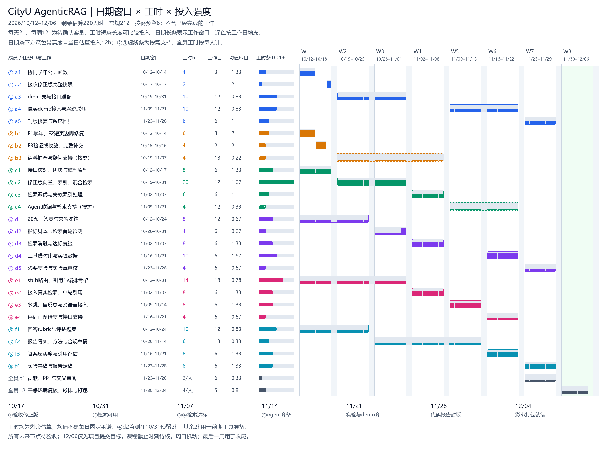
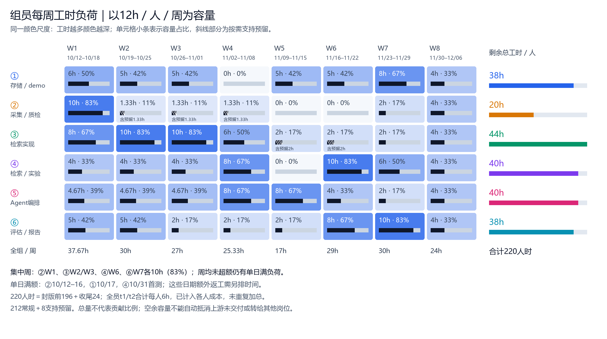

# 排期与工时

分工更新：2026-10-25，Asia/Shanghai。保留2026-10-12的工时与窗口估算供比较，**不是当前剩余工时、实际投入或成员承诺**。实际状态、姓名和对话依据只维护在[协作与需求节点](协作与需求节点.md)；本页给出由它推导的工作窗。旧图中的跨语言任务及⑥集中负责报告/PPT等旧分工不再是当前执行口径。

## 当前可执行顺序

先补N1/N2同版证据；③已上传5282703基础检索源码，补齐运行条件及绑定验收SHA后，④可直接调用Retriever做N6，⑤同时复用它做N5应用接入，不让重复封装阻塞检索首测。⑤与④⑥现在可启动接入和题集。①组长负责交互界面、数据库设计及集成，⑤张宏扬负责查询/Agent后端，④韩上负责检索和数据库实验，⑥燕萍加入Agent侧做rubric、测试集及回答评分。各岗模块素材可并行准备；N7只约束正式Agent结果，不约束上述准备。

组长后续选定统一PPT模板，全员各自制作和审核自己模块；内容准备不等模板，统一排版等模板。报告并稿、视频统筹/剪辑及PPT合并人待确认，不集中追加给⑥。本次调整职责，尚未取得新的剩余人时与个人交付日期，不重算总工时或承诺完工日。

这是**关键依赖链候选**，没有各岗剩余工时/窗口，不声称已算关键路径或余量。不能用旧220人时除以人数推完工日。

## 原计划、实际、新预测分开看

以下原建议日期保留比较用途；截至本轮，真实起止、剩余人时、个人可用窗口和下一反馈时间仍待本人给出。10/24对“数据层完成/检索接近完成”的声明和远端检查已记主状态页，不能直接换成甘特完成条。

| 原建议日期（2026年） | 对应交付 | 当前解释 |
|---|---|---|
| 10/16、10/17 | ②补交、①接收N1/N2 | 原节点已过；用户称完成，当前版本/SHA与语义接受待核，不据此判成员违约 |
| 10/24 | ④⑥冻结N4题集/rubric | 原建议到本轮审查日；未见本人承诺/候选，先邀请启动或回报已有成果；来源冻结需N2 |
| 10/30、10/31 | ③候选/正式N3 | 候选源码已于10/25上传，正式运行待补验；④可直接测可复现Retriever，⑤并行应用接入 |
| 11/07 | N6检索达标 | ③④⑤共同迭代；不阻止⑤提前开发功能 |
| 11/14 | N7完整Agent | 当前英文范围，最终验收需N6 |
| 11/21 | N8实验、回答评分、demo | ④实验、⑥Agent评分、①交互/demo；各岗供视频素材，准备现在做，正式结果按输入分批跑 |
| 11/26—11/28 | 候选冻结、复验、N9签收 | 完整报告PDF及视频候选关口保留，整合人待确认；作者本人审核，受影响结果重跑 |
| 12/04 | N10复核、彩排和包就绪 | 保留为组内保护窗口建议，尚非全员新承诺；不等最后一天找视频或补报告 |
| 12/06 | 截止原文对应月日 | 课程原文“Due Dec 6 by 11:59pm”＝12月6日23:59；片段没有年份/平台时区。表内2026为组内排期年份，须核对平台；现场汇报日期未列 |

上述是原计划加本轮关口解释，不是新预测日历。组内目标、课程截止与本人承诺分别登记；未取得成员新投入确认，不自动顺延或编造新日期。

## 当前甘特行：条件化工作窗

无可靠剩余量时以输入事件代替虚构起止；下表是同一节点状态的排期视图，不另登记完成事实。各行可以重叠，不代表每行一周或等长工时；历史图片保持原样，不涂改为今日进度。

| 岗位／节点行 | 现在可启动的窗口 | 真实输入到齐后的窗口 | 审核/定稿窗口 | 当前实际与新预测 |
|---|---|---|---|---|
| ①组长＋②王尔卓／N1→N2 | 定位现有快照与F项证据、核SHA；①准备设计材料 | 同版语义复核、独立库接收；已修先补验，未修再返工 | ①写接受范围、②解释数据差异，释放N3/N4 | 数据完成为用户声明；当前接受日期待双方反馈 |
| ③王嘉／N3 | 源码已交；补依赖/模型准备、输入SHA、修复切块反例及版本校验 | N2身份确认后正式构建；⑤取件查询、④直接测 | 对④失败逐项优化，版本变更只复验受影响项 | 5282703实现已核；运行、质量、集成及接收待证，非整体完成 |
| ⑤张宏扬／N5→N7 | N5真实检索及单题生成/引用已验证，可供①④⑥接口联调；见协作页11/01增量 | 固定当前数据/模型/索引版本供④首测、⑥试评及①界面接入；再推进N7 | N6后完整Agent正式验收，⑥提供用例及评分 | 11/01本机真实链路已运行，下游接受及正式评测待验，不新增完工时间承诺 |
| ④韩上＋⑥燕萍／N4 | ④检索金标/命中定义，⑥Agent场景/rubric，共用题目ID和来源 | N2后冻结同版来源/题集；④可先纯LLM，⑥N5后试评 | 双方本人核对题集及评分口径，正式金标留评测侧 | ④认领有截图、⑥为组长指派；实际产物及下一反馈待补 |
| ④韩上／N6、N8.数据库 | 20题候选、自动评测及数据库评估脚本 | N4＋③同版可复现Retriever跑检索；固定库到手跑数据库评估，无需等待N7或额外query封装 | 归因反馈③⑤/②、复验；①核对数据库解释 | 未见正式题集/结果；预测取决于运行条件、数据取件与个人容量 |
| ①组长／N8.交互及数据库 | 用mock开发问题输入、答案/来源和失败展示；写ER等设计说明 | N5接张宏扬最小后端并录真实素材；N7后验完整demo | ①核对界面与后端同版，交自己的报告/视频/PPT素材 | 组长已明确承接交互；具体交付时间待安排 |
| ⑥燕萍／N7测试协作、N8评分 | Agent用例、预期动作、rubric和失败分类；与④⑤对齐 | N5可先试评，N7后正式回答/引用/异常评分 | 与④核对版本和结果，交Agent评测章节及自己PPT素材 | 组长已指派；燕萍启动反馈及预计投入待本人确认 |
| 全员／N9模块材料与PPT | 各写自己模块报告、准备图表/视频及PPT内容；组长后续选模板 | 拿到模板后各自套版，正式数字绑定同版验证 | 完整PDF/视频候选及PPT整合，作者审核；整合人待确认 | 不默认由⑥并稿或统筹；原11/26–28仅作比较 |
| 全员／N10 | 确认最终提交人、年份/平台时区和素材需求 | N9固定版后干净环境复核/彩排/链接检查 | 实际平台提交与回执；不以包就绪代已交 | 保留12/04收尾窗口建议；未伪造已确认新日程 |

本次跟进优先：**P0补③可复现运行和N1/N2同版验收；④交检索题集/runner，⑤接后端，⑥交Agent测试集/rubric；P1并行①交互/设计与各岗模块素材，组长后续发PPT模板。** 不重复催③上传已有源码。具名跟进草稿见[岗位提示词](岗位提示词.md#current-followup)。

下一轮只对反馈影响的行重估：本人报剩余实施/理解/验证/交接人时、机器耗时、等待输入、可用窗口和下一次反馈时间，说明是否已承诺。未反馈保留未知，不自动推断零进展。

## 工时分配基线（10/12历史，不作当前派工）

10/25调整后，①增加明确的交互界面职责，⑥聚焦Agent评测，PPT由全员分摊；下表⑥原“报告框架/并稿”等工时仍按历史保留，不能据此重新指派给燕萍，也不能直接按删减项扣出当前剩余量。需要各人反馈后再重估。

220人时＝212常规＋8按需支持，包含每人2h贡献/PPT审阅和4h收尾；不含①②已经完成的历史投入。按需支持未发生不能算实际投入。W1–W8分别为10/12–18、10/19–25、10/26–11/01、11/02–08、11/09–15、11/16–22、11/23–29、11/30–12/06。

| 岗位 | 原任务估算分配（h，不含已完成工作） | 含全员任务合计h |
|---|---|---:|
| ① | 学年协同4、接收2、demo壳10、真实联调10、封版回归6、全员6 | 38 |
| ② | F1/F2修复6、F3/补交4、按需支持4、全员6 | 20 |
| ③ | 原型8、正式向量/索引20、调优6、按需支持4、全员6 | 44 |
| ④ | 题集8、工具/首测4、调优消融8、三基线10、复验4、全员6 | 40 |
| ⑤ | stub/编排14、真实查询8、Agent功能8、评估修复4、全员6 | 40 |
| ⑥ | rubric/题集10、报告框架6、回答评分8、并稿8、全员6 | 38 |
| 全组 | 其中②③各4h按需支持；全员任务共36h已计入 | 220 |

首测4h拆成工具2h和真实首测2h，前者可先完成；⑤真实查询适配与高级Agent分开交付。空余容量不能自动抵消上游迟交；每次延期先看节点输入，再重排受影响工作。

## 工时可视化（历史基线）

甘特图同时表示工作窗口、总工时和日均强度；长条长不等于投入多。图中旧G编号和旧边界用于回看原排期，当前执行使用N0–N10。

图以每人每周12h为容量参考，未重估当前余量。原27任务的逐日/逐周细表保存在Git提交`7f1d43b`的旧`docs/组员排期与甘特图.md`中，当前只维护以上分配和节点状态，避免同时修改多套计划。
