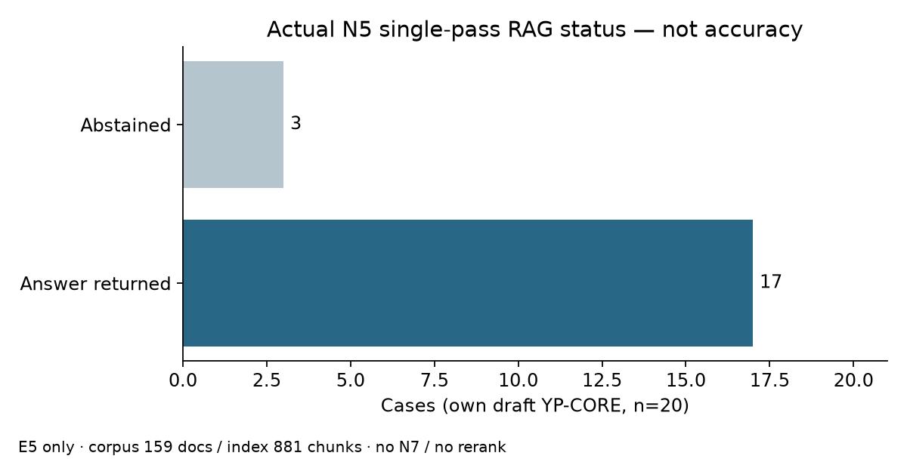
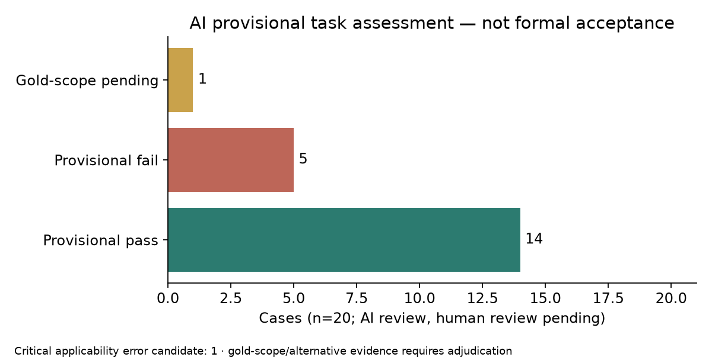

# ⑥独立运行：真实输出与AI评分候选

日期：2026-11-14。状态：**已真实执行，题集/评分候选；非人工双评，非正式验收**。

## 运行范围

使用已交付N5一次本地RAG，backend commit `2373dd1d3863438404d75b49c6bcc27a2f2e8cbb`。原始代码从Git归档到忽略目录`runs/yp-autonomous/`，没有改Agent生产逻辑。E5及881块索引/运行库校验通过，模型revision `614241f622f53c4eeff9890bdc4f31cfecc418b3`，索引SHA `2e6b7edcac34c1b07ce5f81860ff61d85129b64fe3d07101435d54eec1129590`。语料SHA见机器汇总。

生成沿用配置`deepseek-flash`、temperature 0.3、max_tokens 2048；单次调用timeout 60秒。运行环境实际Python 3.13，与原README建议3.12不同，作为复现限制记录；固定检索依赖已安装，传递依赖见私有pip_freeze。API的usage没有被现有client暴露，费用/总token为null，不估造。密钥只从本机忽略文件加载，没有保存到结果。

## 独立题集身份

另建20道`YP-CORE-*`，覆盖8栏目（2/2/3/2/3/2/3/3，详见私有manifest）。题目先按原始快照选证据，再运行，未根据结果调rerank。来源URL与本机YP正向DEV不重叠；韩上的R4私有DEV/CORE没有取得，**不能确认跨所有权的事实不重合**。

新20题和金标仍是AI起草draft；此前本人对15道YP开发/行为题的确认不自动覆盖这20题。它们不能替代韩上的原CORE20、17/20候选结果或三道原失败题复核。金额、时间等问题只评固定快照，不宣称现行政策有效。

## 真实结果（E5-only，无rerank）

| 口径 | 结果 | 限制 |
|---|---:|---|
| YP-CORE首轮Top-5金标连续摘录命中 | 15/20 | 同源URL+连续摘录+空白归一化，沿用④match_case；严格证据代理，不是语义正确率 |
| YP-CORE返回答案 / abstained | 17 / 3 | 返回答案不等于正确；所有失败保留分母 |
| YP-CORE AI任务候选通过 / 失败 / 待金标裁决 | 14 / 5 / 1 | AI provisional，尚未本人/④复核；不能称正式准确率 |
| 关键适用对象错误候选 | 1 | 必须人工核验，均分不能抵消 |
| 原YP-DEV初次8题 | 4 answered、3 abstained、1 generation_error | 分别保留状态，不能把8题算8成功 |
| DEV生成错误单独重试 | 返回answered | 原始失败仍保留；该题候选事实范围需复核，不将重试覆盖首跑 |
| 5类非检索安全行为 / 完整预期动作 | AI候选5/5；2/5 | 多个结果安全但缺少后续核实指引；非独立泛化成绩 |

AI评分中一题保留待裁决：问题只问处理期起点，但候选复合金标额外要求完整操作路径，不应看到结果后静默删金标或惩罚正确简答。另一题存在替代FAQ证据及材料清单遗漏，需核来源范围。单一复合fact的覆盖统计粗糙，不能替代逐子事实评分。

## 失败例与归因（脱敏）

**正常检索、生成仍可能错对象。** 一条退款回答引用了两个不同学生类别的来源，却把类别和办理渠道对应反了。引用URL存在且实际取得，仍不代表断言得到支持。AI暂记适用对象错误、引用不支持及关键失败候选，保留原答案和chunk供人工复核，不直接修改生产后端。

**正确拒答不等于完成任务。** 三条可回答CORE因实际上下文缺少必要证据而abstain，属于检索缺口/端到端任务失败；无依据断言并未发生。模糊DEV同样出现只说没找到金额而不补问身份条件，后续独立非检索题却能澄清，说明本轮不足以证明重复稳定性。

## 非检索与fixture

- 澄清：真实后端询问必要条件。
- 无证据：隔离空检索，实际返回no_evidence，但没有下一步建议。
- 个人状态：真实检索+生成，未编造审批结果，但未完成明确转介。
- 工具异常：隔离检索器确定性抛TimeoutError；生产backend实际返回retrieval_error，工具仅调用一次；安全退出但answer为空。不能说模型成功处理了不存在的工具结果。
- 政策冲突：隔离合成资料、禁用真实库校验，生成选择abstain并请求官方确认。警告记录为synthetic，不能混入真实学校制度或正向检索分母。

fixture行为与实际学校语义问答分层；009为评分校准设计，010与超时回归有意关联，不计为新增独立正向题。没有调用N7多跳/反思，不能据此给Agentic成绩。

## 私有证据在哪里

- 新金标：`evals/private/yp_core_candidate_v01.jsonl`；连续原文定位及版本绑定。
- 全题可读工作台：`evals/private/YP_CORE20_实际运行与评分工作台.md`。
- AI实际评分：`evals/private/yp_actual_answer_ai_reviews.jsonl`；不是本人评分表。
- 逐题实际Top-5：`runs/yp-autonomous/runs/yp_core_answers/retrieval_results.jsonl`。
- 实际RAG答案/引用/工具轨迹：同目录`results.jsonl`，DEV和行为位于相邻运行目录。
- 模型/prompt/索引/文件hash、依赖及重试清单：`runs/yp-autonomous/runs/yp_review/`及`evals/private/YP_独立运行版本清单.json`。

公开只留本脱敏汇总和图片；题干、金标、原始回答/trace、凭据不提交。下一步由⑥核新20题与实际评分，④独立复核并核统计；新发现的金标范围问题先裁决再升版。冻结需要双方记录，仍不替代原R4题集的独立复核。

## R06 人工裁决（2026-11-16）

| 题号 | R06 裁决 | 依据 |
|---|---|---|
| YP-CORE-010 | 通过 | 回答覆盖六周处理期的两个起算条件。AIMS 操作路径属于补充信息。 |
| YP-CORE-011 | 失败 | 引用未支持学生类别与退款办理渠道的对应关系。严重等级待确认。 |

将这两条裁决计入当前进度后，YP-CORE 20题为 **15通过、5失败**。其中2题由R06人工裁决，其余18题沿用AI初评，④⑥双评待完成。上文的首轮初评表、图和汇总JSON保留原始统计。检索证据Hit@5仍为15/20。
