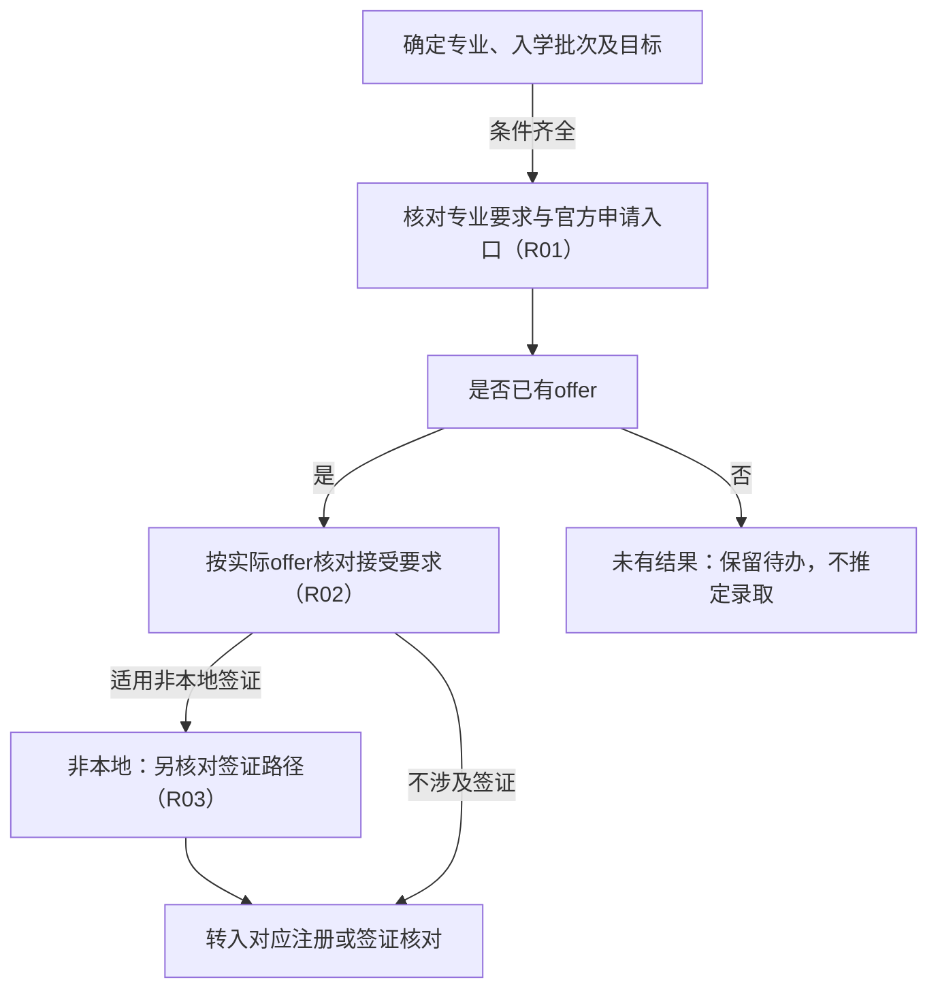
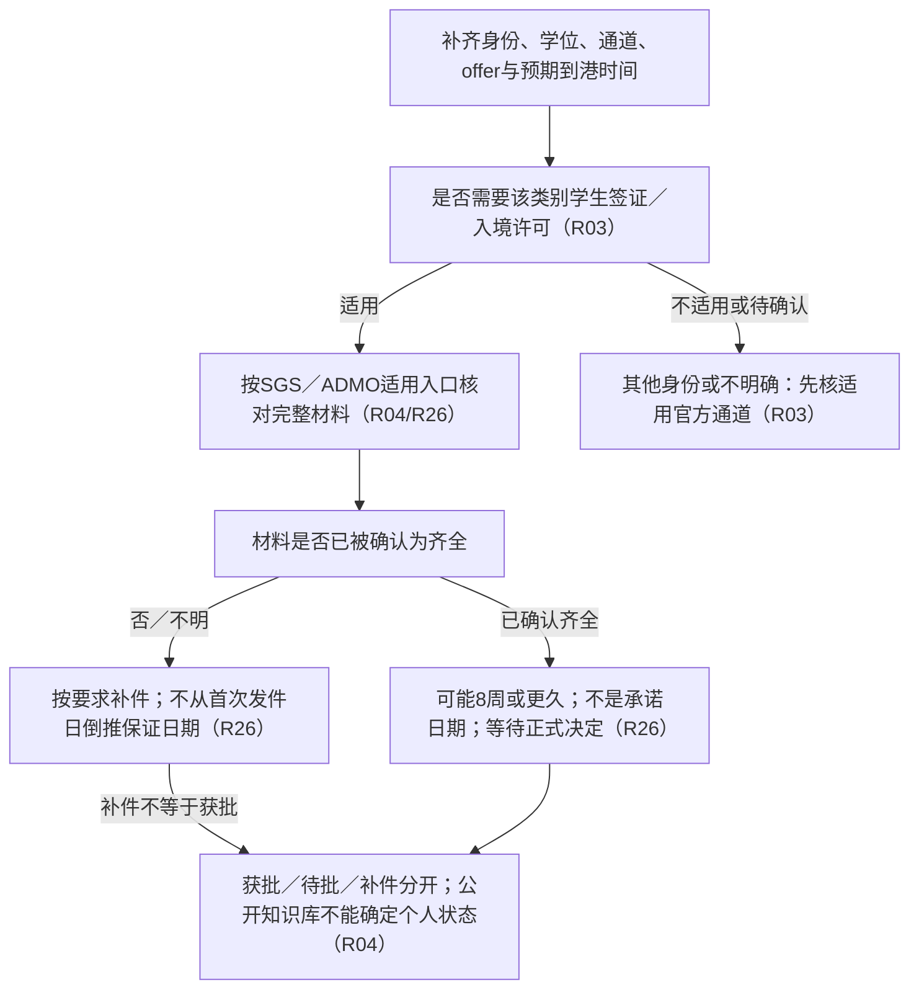
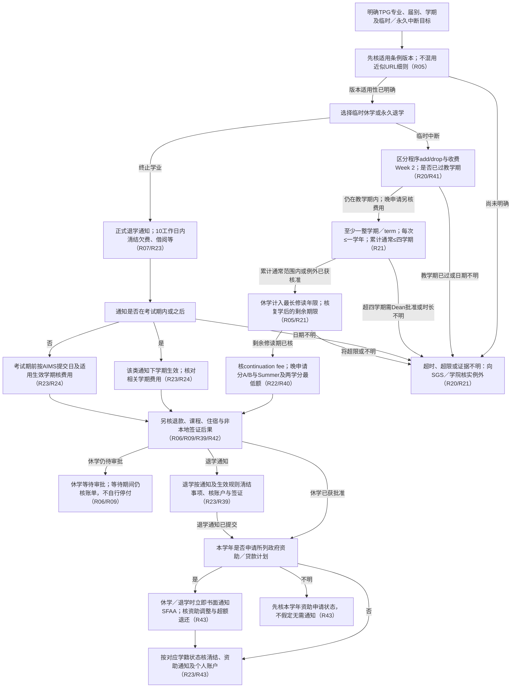
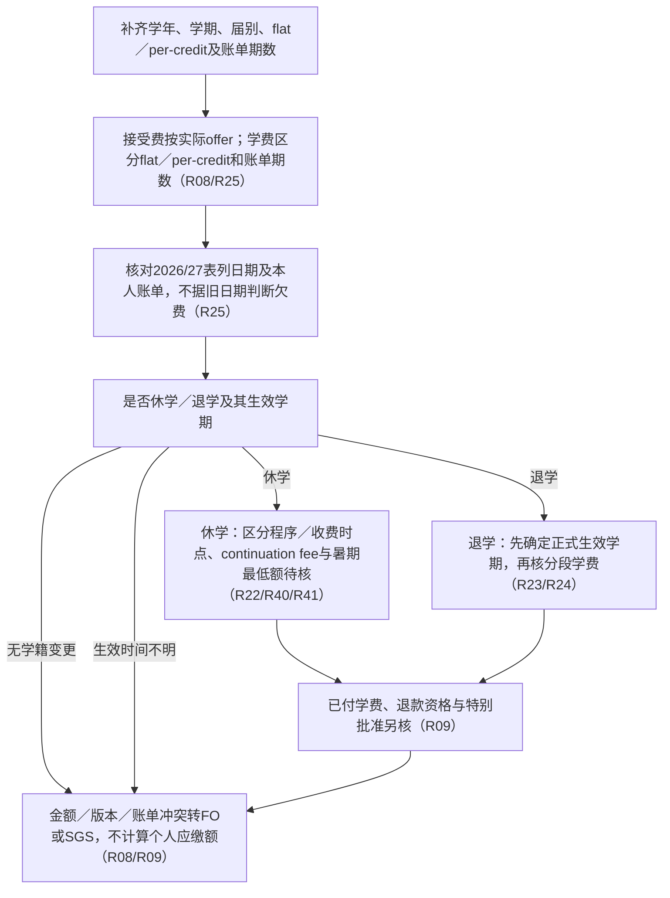
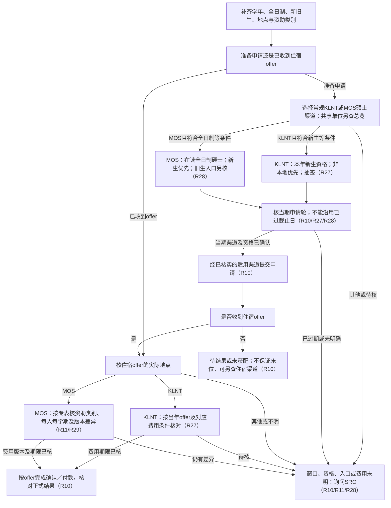
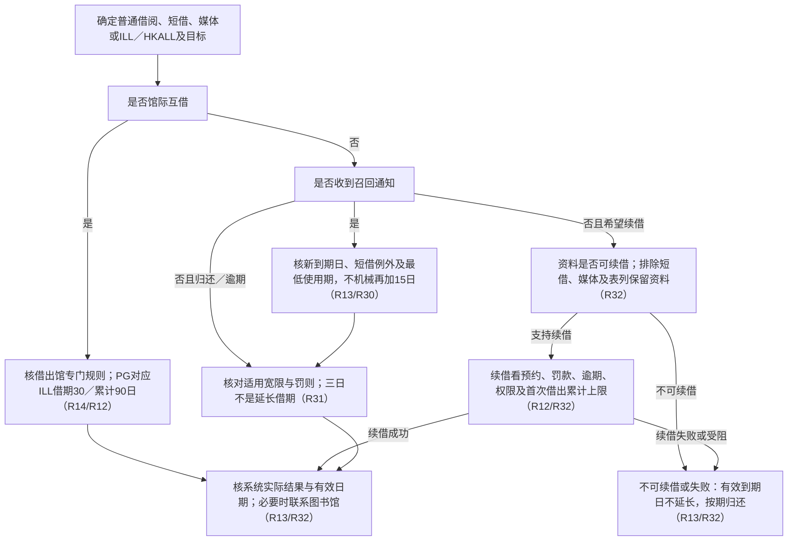
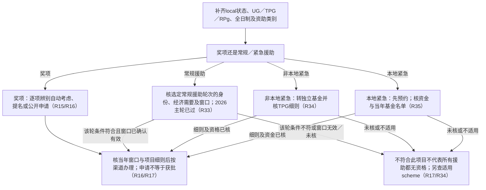
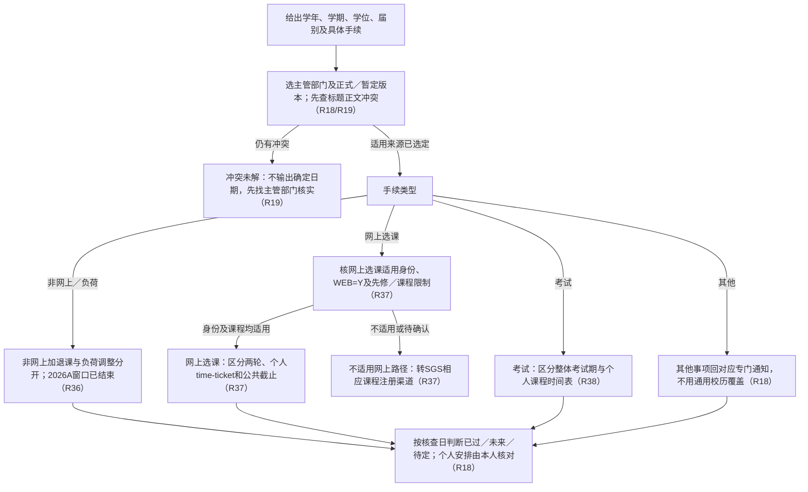

# 制度规则与目标流程：研究结论和维护入口

研究日期：2026-10-26，Asia/Shanghai。结论：采用现有官网正文库，加一个**按适用对象组织的规则目录和目标流程视图**。上层保留8个主题，优先做授课型硕士相关高频目标。本目录是研究候选，尚未形成获准使用的现行政策知识库。

## 对原方案的评价

“官网核真→分类规则→按目标画流程”适合本项目，比再造合成知识库更有价值。还需补足五件事：

1. 分类不能只有主题：另记学位、local状态、入学届别、当前学年、学期、收费口径、制度有效期；未知就保留未知，不能当作全部适用。
2. 保留原文及来源定位。摘要与流程都是派生解释，不能取代原文；条件、例外和例外审批不能在切块或归纳时消失。
3. 区分事实状态。官方URL、搜索索引、取得完整正文、适用性复核、人工批准是不同证据；HTTP 200也可能没有政策正文。
4. 把制度、操作步骤和个人状态分开。符合条件、提交申请、获批、缴款确认并不是同一个结果；公开知识库不能判断个人审批或欠款。
5. 流程节点引用规则ID并保留未解决分支。金额、日期、资格冲突时转人工核实，不能为了画出一条完整箭头而补造步骤。

| 方案 | 本项目的得失 | 判断 |
|---|---|---|
| 继续只检索整页网页 | 可追到原文，但跨页条件、届别和例外容易漏掉 | 保留为原文层及对照基线 |
| 只存分类摘要与流程图 | 易读，但来源更新后难找受影响结论，容易把归纳误当制度 | 不单独使用 |
| **原文＋来源登记＋原子规则＋目标流程** | 增量较小；规则、例外、来源和受影响流程可一同维护 | **本轮推荐** |
| 现在引入完整知识图谱或GraphRAG | 本轮问题首先是政策覆盖、适用范围和证据缺失；图谱仍需可靠抽取与审核 | 当前不作为启动依赖；有明确多实体关系需求再评估 |

规则表回答“哪些条件下适用什么规定”；流程图回答“为这个目标接下来核对或办理什么”。这与决策表和业务流程分工一致，可参考OMG的DMN/BPMN；目前用JSON和Mermaid表达即可，不必安装决策引擎。来源与派生关系参考W3C PROV的思路。以上是本项目设计判断，不是课程强制技术选型。

参考： [OMG DMN](https://www.omg.org/dmn/) · [W3C PROV](https://www.w3.org/TR/prov-overview/) · [GraphRAG索引说明](https://microsoft.github.io/graphrag/index/overview/)。

## 本地数据库说明了什么

两个agent分别完成只读数据库审计和4类官网研究；主agent补查申请、签证、学籍与费用，并整合方案。数据库以SQLite `mode=ro`读取，未查看个人问答日志，未导入、迁移或重建索引。范围为已定位的代表性快照和数据库，未遍历压缩包或穷尽全部历史副本。

| 已核实事项 | 对方案的影响 |
|---|---|
| 研究主候选159行、159个URL；另两份159行副本SHA相同 | 是同一份候选底稿；不能把副本数量当覆盖量。历史158行删签证实验不能冒充正式新快照 |
| 八主题计数：申请25、签证12、学籍18、宿舍24、费用13、奖助19、图书馆40、校历8 | 这是旧栏目归属，不是有效政策条目数量；内容需重新按规则与适用范围审视 |
| 集成库`records=83`，`documents=159`，活动159、dirty159、`chunks=0` | 研究应读活动文档快照；不能用旧records重导出，也不能据此宣布E5检索可运行 |
| 10/26研究时发布项目`data/`仅有`.gitkeep`；10/31按组长授权发布159条同版JSONL与脱敏SQLite | 当前开发基线可随Git取得，SHA见`data/release_manifest.json`；不把物理取件或公开发布当作政策语义接受 |
| 119条`academic_year`为空；有`2026-2021`、`2025-2028`；一页正文2026/27但字段2020-2021 | 既不能自动填当前学年，也不能用不可靠元数据直接过滤。先核正文，必要时修②的字段提取 |
| 147条`date=crawled_at`；采集日期为2026-09-26至2026-10-11 | 不能把采集时间当制度生效日期；旧年也可能是制度实施起点，不能一律判失效 |
| SGS在159行中仅有`masters/nonlocal`；未找到硕士学术条例两个近似路径 | “注册与学籍18页”并不代表硕士条例已覆盖，需定向补页 |
| 71条有附件，共207个链接、94个独立PDF URL；未证实附件正文被解析 | 附件链接不等于可检索政策正文；官方流程图、细则PDF须另核内容和版本 |

研究快照SHA-256：`2c3f9a2d9dc116062791e8c646ad7e343fd8e22f5a59c91581f84808b0620752`。这是研究输入身份，**不是N2接收通过或政策现行有效的结论**。159行主快照与主库活动文档逐字段一致，但既有质检仍是`semantic_review=pending_member2`、`release_ready=false`。

## 官网核查的结果与边界

本次累计登记30个官方来源入口、43条候选记录和8个目标流程，另将2026/27付款表拆成7个带条件的日期条目；未声称穷尽官网。**18条来源登记项已取得完整正文并绑定真实响应及提取文本SHA，共17个不同正文SHA**；两个硕士条例路径本轮正文相同，不能将登记数当作独立政策数。其余11条主要获官网索引支持，1条offer流程图仍只有入口：本轮虽然返回HTTP 200和PDF类型头，536字节响应不是可用PDF。普通HTTP短页和搜索索引不当作完整快照，索引时间也不当作生效时间。

主要发现：

- 两条学术条例路径本轮提取正文SHA相同，标题也已核实：主文本适用于2022/23前或2024/25起入学者，以及所有PCLL；2022/23至Summer2024非PCLL另用专用版本，该PDF尚待取得。当前一致不代表所有历史版本相同，旧159行研究语料仍缺这些原文。
- 学籍流程补到可辨别分支：首学期拟休学、休学最短时长／单次与累计限制、退学通知在考试期前后的生效差异。**休学不是至少提前两周；退学的10工作日指清结事项，不是审批耗时。**当年申请所列政府资助／贷款者另有书面通知义务，不能用账户清结代替。申请程序的add/drop时点与收费的Week 2分界分别核日历；首学期休学并非必须退学，另核签证担保后果。
- 费用保留A/B与Summer不同的晚申请分段、按学分收费的最低两学分金额，以及休学continuation fee；SGS细则与FO暑期表对两学分最低额的呈现差异保留待核；“无学费”不能写成“零费用”。付款表保留flat／per-credit、第一／第二次账单、入学届别的预缴／抵扣条件。日期候选不等于个人应付日或欠费状态。
- 住宿图限定常规KLNT／MOS，共享单位另查总览；两地点费用不交叉套用。MOS的2026/27专门费用已核全文，不采用总览旧年参考价。申请、获offer与确认付款有独立阶段。MOS学生主动退出与校方启动退出有不同退款条款，同页概括不退与例外并存，保留待复核分支；旧生入口和当前替代渠道仍待核。
- **修正旧证据绑定：S11入门全文没有累计期限表；R12改引用已取得全文的S24。**现已补出PG普通借期120日／累计720日、ILL+HKALL的30日／90日及不可续借类别；仍以适用资料行、召回和实际续借结果为条件，不作无条件借期承诺。
- 奖助分清2026/27常规本科主轮、本地紧急与非本地紧急渠道，不能把本科资格扩展到TPG，也不能因某方案不适用就判定所有援助都不可申请。
- 日期分网上选课、非网上加退课、负荷调整及考试期。已过窗口明确写绝对日期；个人time-ticket、个人考试日程仍须本人核对。S16标题正文冲突保持未解决，不阻止另记独立来源支持的日期候选。

`catalog.json`逐来源记录访问层级和本地URL匹配情况。原16个目标URL有7个与研究快照按原路径及尾斜杠对齐；新增URL也逐项按同一规则检查，不能据未匹配断言附件或别名不存在。精确URL匹配数不等于有效政策覆盖率。

43条记录中，39条是官方内容的候选摘要，4条是研究者设定的版本／冲突核对规则，`kind`分别标记。所有记录和付款条目保持`candidate`，取得全文也没有代替②⑥人工批准；**流程是研究导航，不是官方原图或可执行审批流程**。具体缺口、主责和解除阻塞条件统一列在本页末尾，不另出交接报告。

## 原文快照如何交接

Git中的URL、短证据和SHA用于定位与核对，**不包含完整原文**。组员克隆后，这些本机忽略文件不会自动出现；18条已取全文来源的证据状态也不代表接收者已经拿到原文。

| 谁交给谁 | 组内交付内容及本机目标位置 | 接收条件 |
|---|---|---|
| ①当前保管者→②语料质检、⑥适用性复核 | 按`catalog.json`中`sources[].snapshot.relative_path`和`text_relative_path`逐项取件，保持仓库相对路径。当前均在`runs/policy_research/continuation_20261026/<capture_id>/approved_retry/`；不同来源的capture_id不一定等于来源ID，以登记字段为准 | 原始响应字节对`official_snapshot_sha256`，提取文本字节对`snapshot.text_sha256`；记录取件人、日期及校验结果。没有实际接收者确认时仍记待取件 |
| ②→①→③④⑥ | 核实缺页、附件、身份/届别和F项后，另交完整`data/corpus.jsonl`、质检及真实SHA；①按N2接收后再分发 | 本轮17种提取正文与旧159行快照不是同一个数据集；不能把本目录快照路径当作已合并语料、已更新数据库或索引 |

交付原文时仅挑选登记的响应体及提取文本，保留来源URL、UTC抓取时间、格式和局限的必要说明。不得打包整个`runs/`或浏览器目录，避免夹带cookie、认证头、缓存、个人问答和调试日志；原文仍走组内渠道，公开仓库保留本目录的候选摘要与登记。原始字节不要编辑换行，示例核对命令为`Get-FileHash -Algorithm SHA256 -LiteralPath <登记的相对路径>`；SHA匹配只证明文件一致。

原保管者未交付时，可以根据来源URL重新获取以继续研究，但新内容须登记自己的时间、SHA和版本；不能为了匹配旧SHA而修改文件，也不能未经取得文件就沿用“已取件”。403、无效PDF、仅索引和条件冲突仍按K01–K08处理。本文说明交付方法，尚未创建组内附件包、指定实际传输链接或代②⑥确认取件。

## 轻量落地方式

唯一结构化底稿为[catalog.json](catalog.json)：`sources`登记来源与访问证据，`rules`保存原子规则与范围，`workflows`引用规则组织目标步骤。下方规则表和流程图由脚本生成，避免另维护一份摘要。现有12字段`corpus.jsonl`保持原契约；本目录不能直接交给③的`load_corpus`充当运行语料。

| 材料 | 用途与存放位置 | 与模型/评测的边界 |
|---|---|---|
| 原文知识库 | 已发布的159条`data/corpus.jsonl`与脱敏数据库，绑定`data/release_manifest.json`；新增附件正文和索引另行交付 | 检索依据；发布及采集快照不自动等于现行政策核验通过 |
| 来源、规则和流程目录 | 本目录；当前研究候选，后续经复核才生成检索视图 | 只允许经批准且与原文绑定的派生内容进入运行知识库 |
| golden题集 | ④⑥根据已核实原文另做`evals/private/dev.jsonl`、`core.jsonl` | 问题以外的预期事实、动作、评分标签留在评测侧；不要把题集加入索引 |
| rubric | `evals/rubric.json`，规则见[评测入口](../evals/README.md) | 是通用判分标准，不是学校制度，也不是知识库正文 |

规则来源可与golden证据是同一篇官网，这是RAG应能检到的知识；禁止的是把测试题、标准答案与判分标签作为知识塞入。比较RAG与Agentic RAG时共享同一语料和规则视图；若加入人工规则整理，分别报告整理前后结果，不把知识库增强收益都算给Agent编排。

执行顺序：

1. ②先核正文、缺页与附件，修复明显错误学年；①确认接收的快照身份。优先补硕士条例、休学/退学、硕士住宿、图书馆借阅细则等政策页，不重爬整站。
2. 对每个目标核对身份、届别、当前学年与例外。Agent只负责发现、提取候选与标冲突，②和相应评测复核者独立读官方原文；证据不足保持candidate。
3. 记录完整原文快照SHA、定位、短证据、审核岗位与日期。来源更新时回查受影响规则和流程；旧版不静默覆盖。来源权威性、适用范围、生效时间共同判断，不能机械认为某一类页面永远覆盖所有其他页面。
4. ③保全条件与例外并形成可检索视图；⑤按目标选可能涉及的多个主题，缺少关键条件先澄清，不能只用单个硬主题过滤漏掉费用/签证后果。流程图目前只做导航，不自动提交、付款或操作账户。
5. ④做证据覆盖与检索统计，⑥做必要事实、预期动作及回答/引用评分，共用ID和来源；再冻结真实DEV/CORE20。规则审核和golden复核分开，不让系统自己给自己生成与验收标准。

先验证本目录结构和视图同步：

```powershell
python -m scripts.check_policy_assets
# 修改catalog后重新生成下方视图
python -m scripts.check_policy_assets --render
# 当前预期失败：本目录尚未通过真实来源与人工批准关口
python -m scripts.check_policy_assets --require-ready --corpus data/corpus.jsonl
```

程序检查结构、引用、来源域名、付款条件、流程各分支能否到达终点及人工记录条件；不能证明解释正确或审核实际发生。②补原文和适用性，①接收同版语料，③⑤可先做接口，④⑥可先做rubric／runner；正式规则、索引和成绩分别等待对应输入。本轮未改生产数据库、生成正式golden或宣称四模式已实现。公开目录只存候选摘要与来源；个人状态、原文全文和抓取／审计日志留忽略目录。

<!-- GENERATED POLICY VIEWS: edit catalog.json, then run scripts.check_policy_assets --render -->

## 分类制度与规则表（43条）

本版规则状态均为研究候选；后续状态以catalog记录为准。英文statement见catalog，表内保留适用条件与例外。

| 规则／主题 | 内容与适用对象 | 限制、例外及来源 |
|---|---|---|
| R01／申请（官网候选摘要） | 申请入口与专业要求分开核对；申请授课型硕士 | 不要把一个专业的截止日当全校共同日期。 来源：S01 |
| R02／申请、学费与缴费（官网候选摘要） | 按offer确认接受要求；已经收到相应offer的TPG申请人 | 官方已有接受offer流程图入口，但图中步骤本轮未取得；不自行补造固定金额、时限或按钮。 来源：S01 |
| R03／签证与国际学生服务、申请（官网候选摘要） | 录取与签证审批分开；需要学生签证/入境许可的非本地申请人 | 按身份与课程类别选SGS/ADMO相关通道；不访问个人审批账户。 来源：S03, S04 |
| R04／签证与国际学生服务（官网候选摘要） | 办理周期不构成获批承诺；适用签证担保流程的申请人 | 处理周期、建议提前量、材料补交与个人结果是不同字段；不生成必批或具体到期承诺。 来源：S03, S04 |
| R05／注册与学籍（官网候选摘要） | 按入学届别与PCLL身份选条例，近似路径本轮正文相同；TPG；PCLL及不同入学届别须另核对 | 主文本自2024/25生效；两路径本轮提取正文SHA相同，不代表所有历史版本相同。2022/23至Summer2024非PCLL专用PDF未取得；该范围仍不得据主文本细则判断。 来源：S05, S19 |
| R06／注册与学籍、学费与缴费、签证与国际学生服务（官网候选摘要） | 休学与退学分流；TPG，个人状态与条件需补齐 | 休学申请由学术单位Head审批，回执不等于批准，决定后在AIMS查看结果；退学按正式通知规则生效。两者的课程、费用、住宿及签证后果分别核。 来源：S06, S07 |
| R07／注册与学籍、学费与缴费（官网候选摘要） | 停止上课不代表手续完成；需要退学的TPG | 申请、学校处理结果、课程状态及退款是不同结果；不替学生提交申请。 来源：S07, S17 |
| R08／学费与缴费（官网候选摘要） | 按对应缴费表与个人账单核对；TPG；当前学年和收费口径必须明确 | 不从公开政策推定个人欠款；不使用研究快照中的错误academic_year元数据。 来源：S09, S18 |
| R09／学费与缴费、注册与学籍（官网候选摘要） | 退课退学与退款分别判断；TPG；须看课程及获准例外 | 须核对适用条款、例外及学校决定；不概括成所有情况一律不退。 来源：S07, S18 |
| R10／宿舍（官网候选摘要） | 硕士住宿渠道及结果分开；2026/27全日制硕士；具体课程仍待确认 | 不能套用UG首年/首两年优先权；普通与共享单位渠道、地点及确认阶段分开。 来源：S10, S20, S21 |
| R11／宿舍、学费与缴费（研究核对规则） | 住宿总览旧参考价与当年专表须分别核实；需要核对2026/27硕士住宿费用者 | S22的2026/27专表现已取得全文；S10总览仍保留旧年参考价。按资助类别及费种选择对应专表，旧价不覆盖当年专表，个人应付额仍核实际offer／账单。 来源：S10, S22 |
| R12／图书馆（官网候选摘要） | PG普通借期120日、累计720日；ILL为30日／90日；图书馆可续借资料；按用户及资料类别核对 | 以S24对应借阅人／资料行适用为前提；累计从首次借出计，召回可提前到期，不将次数不限解释为无限借期。S11入门指南没有本表；不是所有用户都用PG额度。 来源：S24 |
| R13／图书馆（官网候选摘要） | 召回新日期覆盖原日期；收到资料召回通知的借阅者 | 个人实际到期日须由用户自行查通知/账户；系统不索取账号密码或OTP。 来源：S11 |
| R14／图书馆（官网候选摘要） | 馆际互借按专门规则归还续借；ILL/HKALL或海外馆资料借阅者 | 不套用普通还书箱或普通续借流程；具体材料类别和审批结果待查。 来源：S12 |
| R15／奖学金与助学金（官网候选摘要） | 奖项渠道并不统一；已选定具体奖项的学生 | 概述中的无须另行申请仅适用于对应奖项类型；不得推广至所有奖助学金。 来源：S13 |
| R16／奖学金与助学金（官网候选摘要） | 资格按具体奖项逐项判断；须明确学位、年级、local状态及资助类别 | UG、local或非毕业年专属条件不能扩展到非本地TPG；提名不等于获奖。 来源：S13 |
| R17／奖学金与助学金（官网候选摘要） | 常规经济援助与紧急援助分流；以所选scheme列出的身份为限 | 概述的full-time local条件不证明非本地TPG适用；惯常月份不是当年开放证明。 来源：S14 |
| R18／校历与重要日期、注册与学籍（研究核对规则） | 日期须匹配学年学期与主管部门；查询某一具体手续日期者 | 区分正式、暂定、历史安排及个人time-ticket；不能以索引抓取时间当生效时间。 来源：S15, S16 |
| R19／校历与重要日期、注册与学籍（研究核对规则） | 冲突或已过窗口须停下复核；查询选课及手续窗口者 | S16标题与正文有学年冲突；本草案不发布具体截止日或宣称窗口仍开放。 来源：S16 |
| R20／注册与学籍（官网候选摘要） | 休学应在加退课期结束前申请，教学期后不受理；拟申请TPG休学者 | 通过AIMS的Student Record→My Applications→Leave of Absence提交；证明可在提交后4个日历日内补传。程序add/drop与费用Week 2分界分开核当年专业日历。 来源：S06 |
| R21／注册与学籍（官网候选摘要） | 休学至少一整学期／term，每次不超一学年；按适用硕士条例申请休学者 | 保留normally；超四学期需Dean例外批准。休学计入最长修读年限，不能默认延长；不擅自添加暑期不计入的结论。累计已用时长与复学手续须由SGS核实。 来源：S06 |
| R22／注册与学籍、学费与缴费（官网候选摘要） | 休学晚申请须分A/B与Summer收费；TPG休学申请及相关学期费用核对 | A/B按学分收费须与最低两学分金额取较高值。SGS细则对Summer也写最低额，FO暑期表未重复此项，不能自行视为豁免；早申请continuation fee另见R40。实际课程与特别批准另核。 来源：S06, S18 |
| R23／注册与学籍（官网候选摘要） | 退学须在通知后10工作日内清结义务；拟终止TPG学业者 | 10工作日为清结欠费、借阅等，并非审批耗时；通常按AIMS提交日生效，考试期内／后转下学期。SGS与非本地说明对离境时限起算用语不同，不据此推算个人离境日。 来源：S07 |
| R24／注册与学籍、学费与缴费（官网候选摘要） | 退学也有50%／100%收费分段；TPG正式退学者及其适用收费学期 | A/B第3–6周50%、第7周起100%；Summer第3周50%、第4周起100%。SGS细则列最低两学分，FO暑期表未重复该脚注，需核口径；接受费不退，其他退费按费种及正式生效时点另核。 来源：S07, S18 |
| R25／学费与缴费、校历与重要日期（官网候选摘要） | 付款表须保留flat／per-credit及两次账单；2026/27 TPG按适用付款表及本人账单核对 | 日期见下方结构化表；按学分收费还区分2019或以前届别的两学分预缴、2020起届别的分期抵扣。不是通用三个截止日；申请休学／退学等待结果时仍需核付款义务，不能自行停付。 来源：S18 |
| R26／签证与国际学生服务、申请（官网候选摘要） | 签证可能需8周或更久，材料不全不处理；适用ADMO非本地新生签证通道者；TPG须另核SGS入口 | 这是处理估计而非获批保证；不能从首次发件日推算固定完成日。先核SGS／ADMO适用通道、接收、完整材料与正式决定，勿套用于所有签证类别。 来源：S03, S04 |
| R27／宿舍（官网候选摘要） | KLNT硕士渠道：新生资格、非本地优先、抽签；2026/27新入学全日制硕士 | 2026-05-27原定截止已过；当前补申请／床位未确认。优先权和合资格都不等于保证分配；全年床位及两期付款另看offer。 来源：S20 |
| R28／宿舍（官网候选摘要） | MOS资格不限于新生，但新生优先；全日制在读硕士；2026/27申请渠道 | 不要将KLNT只限新生的资格搬来MOS；MOS页面明确新生提交方式，旧生入口须问SRO。房型取决于供应，不能承诺PG楼或床位。 来源：S21 |
| R29／宿舍、学费与缴费（官网候选摘要） | MOS当年专表按人、学期及资助类别收费；2026/27 MOS双人房对应资助类别的住宿者 | 已核Hall 13及14–17双人房2026/27专表全文；不是全年或整间房价。空调、洗衣及寝具另计；全年床位分两期付款，仍按实际offer／账单确认。旧年总览价不用来替代专表。 来源：S22 |
| R30／图书馆（官网候选摘要） | 召回的15日规则有短借例外；普通流通借阅且受到召回者 | 条文另保障最低15日使用期；不能简化成收到召回后必可再借15日。以系统新日期核对；ILL、HKALL及其他资料另查专门规定。 来源：S23 |
| R31／图书馆（官网候选摘要） | 三日宽限不是借期延长；普通／召回资料且适用该宽限条文者 | 未收到或未读通知不自动免罚；不将三日规则扩展至所有保留资料或媒体。资料类型、闭馆日与现行罚率仍需核对。 来源：S23 |
| R32／图书馆（官网候选摘要） | 续借会受预约、罚款和权限阻断；支持续借的资料及借阅人 | 超过HK$30不能改成大于等于；短借、媒体及表列保留资料不可续借。累计上限从首次借出计算，新日期从续借当天计；失败不延长有效到期日，须按期归还。 来源：S24 |
| R33／奖学金与助学金、校历与重要日期（官网候选摘要） | 常规主轮援助限特定本科群体；2026/27 CityUHK Financial Assistance Scheme主轮 | 不能扩展至TPG；本轮2026-09-25 17:00已截止。迟交或不完整申请无合理解释通常不受理；未确认第二轮，不能承诺重新开放。 来源：S25 |
| R34／奖学金与助学金（官网候选摘要） | 非本地紧急援助另有分流入口；非本地全日制、发生紧急经济需要者 | 指向Jennifer and Haywood Cheung Emergency Fund，须再核基金细则与TPG资格；获studentship研究生临时贷款及本地ENLS不能与之混同。概览不是个人符合资格的结论。 来源：S26 |
| R35／奖学金与助学金（官网候选摘要） | 本地紧急援助全年可提出但受资金限制；本地全日制突发经济困难学生；具体基金适用性待核 | 全年可提出不代表随时有资金；个别基金清单仍标2025/26，2026/27名单及TPG适用性待核，不能套常规本科主轮截止日。 来源：S27 |
| R36／校历与重要日期、注册与学籍（官网候选摘要） | 非网上加退课与负荷调整截止不同；2026/27 Semester A硕士相关手续 | 截至2026-10-26两窗口均已结束；页面没有统一每日截止时刻则不补造。迟交或例外走SGS核实，不能承诺可以办理。 来源：S28 |
| R37／校历与重要日期、注册与学籍（官网候选摘要） | 网上选课分两轮并看个人time-ticket；2026/27 Semester A硕士网上选课 | Elder Academy、内地校区、外出交换／合作项目、visiting等类别不适用网上选课；课程还须WEB=Y并满足先修及课程限制。“all courses”是轮次范围，不保证人人可选所有课。个别time-ticket另核；窗口已结束，S16冲突仍待核。 来源：S29 |
| R38／校历与重要日期、注册与学籍（官网候选摘要） | 考试期不能替代个人考试表；2026/27 Semester A硕士期末考试 | 时间表列教学第10周公布；截至2026-10-26考试期尚未开始。不能据整个考试期推断某门课程考试日，天气改期及课程例外另核。 来源：S30 |
| R39／注册与学籍、签证与国际学生服务（官网候选摘要） | 首学期休学与退学分别核对签证担保后果；非本地学生签证持有人，首学期休学或正式退学 | SGS休学页列首学期休学从生效日起4周或签证到期取早；退学页列从通知提交日起4周或签证到期取早。两者起算不同；个人条件与现行移民要求须向SGS／相关主管机关核实。 来源：S06, S07 |
| R40／注册与学籍、学费与缴费（官网候选摘要） | 早申请休学仍有continuation fee，Summer为零；TPG；具体学期、入学状态与批准条件需补齐 | 申请于Week 2结束前提交且随后获批准，才按相应条件收continuation fee；不要求审批也在Week 2前完成。Summer零continuation fee不代表其他费用全免，实际账户另核。 来源：S06, S17 |
| R41／注册与学籍、学费与缴费（研究核对规则） | 申请程序时点与费用分界不能混为同一日期；TPG；具体学期、入学状态与批准条件需补齐 | 申请程序与收费分界分别核专业日历；SGS收费周次以周日为每周首日。非标准校历课程按专业规定，不直接用选课截止换算休学截止。 来源：S06, S18, S28 |
| R42／宿舍、学费与缴费、注册与学籍（官网候选摘要） | MOS退宿须区分主动退出与校方启动的退款例外；2026/27 MOS住宿者，原因及费种须明确 | 学生因休学等主动提早退出一般不退；校方因学术／纪律等启动的条款列住宿费按日比例退、确认费除外。同页末尾又概括已付不退，需SRO核例外，不能丢掉该分支或自行计算。 来源：S22 |
| R43／注册与学籍、奖学金与助学金（官网候选摘要） | 当年申请所列政府资助者，休学／退学须另行书面通知；本学年申请Local Student Finance Scheme或Non-means-tested Loan Scheme者 | 这项通知独立于大学账户清结；资助超额须按要求退还。不适用者跳过，申请状态不明先核实，不将本义务扩展到所有学生。 来源：S06, S07 |

## 2026/27付款表的条件化登记

日期按已取得的官网全文登记，仍为待人工批准的候选；日期状态只相对于本目录核查日，不代表个人欠费。接受费另按本人offer核对；本表不计算个人费用。

| 学期 | 收费口径／账单 | 表列日期 | 相对核查日 | 规则／来源 |
|---|---|---|---|---|
| A | flat整笔学费 | 2026-08-31 | 已过 | R25, S18 |
| B | flat整笔学费 | 2027-01-11 | 未来 | R25, S18 |
| A | 按学分／第1次账单 | 2026-08-31 | 已过 | R25, S18 |
| A | 按学分／第2次账单 | 2026-09-28 | 已过 | R25, S18 |
| B | 按学分／第1次账单 | 2027-01-11 | 未来 | R25, S18 |
| B | 按学分／第2次账单 | 2027-02-15 | 未来 | R25, S18 |
| Summer | 按学分 | 2027-07-05 | 未来 | R25, S18 |

按学分收费还区分入学届别的预缴／抵扣安排；A/B晚申请的两学分最低额、Summer分段和continuation fee见R22、R24、R40。SGS细则对Summer也写最低额，FO暑期表未重复该脚注，不能自行当作豁免。申请程序add/drop与收费Week 2分界分别核专业日历（R41）。

## 八个目标流程（研究导航图）

各图以条件已补齐为前提；条件缺失先澄清。节点中的R编号回查上表，跨主题流程不是单一栏目的顺序清单。

### F01 申请TPG并处理录取通知



### F02 准备学生签证与入境许可



### F03 决定休学还是退学，并核对后果



### F04 核对缴费或退费



### F05 常规KLNT／MOS硕士住宿：申请与获offer后确认



### F06 续借、召回与归还资料



### F07 找奖学金或经济援助渠道



### F08 确定某项手续的有效日期



## 官方来源登记与核实状态

A＝本轮完整正文可读；B＝官网索引支持；L＝仅确认入口。均不自动代表现行有效或人工批准。

| ID／来源 | 层级及实时结果 | 研究快照对齐 | 定位与待核事项 |
|---|---|---|---|
| [S01 TPG: Steps for Applying](https://www.cityu.edu.hk/pg/taught-postgraduate-programmes/steps-applying) | B／not_confirmed | 未按该URL对齐 | Submission of Applications / acceptance；官网索引支持网上申请入口；各专业及offer具体条件仍需逐项核对。 |
| [S02 Flow Chart for Accepting Offers of Master's Programmes](https://www.cityu.edu.hk/sgs/files/prospective/tpg/faq/flow_chart_for_accepting_offers_of_master%27s_progs.pdf) | L／http_200_non_pdf_body | 未按该URL对齐 | official PDF flow chart；浏览器本轮返回200及application/pdf头，但响应只有536字节且没有%PDF签名；未取得可用PDF，不读图、不转录操作。 |
| [S03 Student Visa: Postgraduate](https://www.cityu.edu.hk/sgs/student/masters/visa) | B／not_confirmed | 未按该URL对齐 | student visa / sponsorship / supporting documents；官网索引支持非本地硕士签证手续；个人审批结果与现行完整材料清单未取得。 |
| [S04 Student Visa / Entry Permit](https://www.cityu.edu.hk/admo/non-local-students/visa/student-visa) | A／http_200_body_verified | 独立正文第22行 | Before you apply / complete documents / processing time；已核全文与SHA：新入学及在读学生通道不同；可能8周或更久，缺材料不处理；学校行政费与入境处签证费分开，获批及入境验证分开。 |
| [S05 Academic Regulations for Taught Postgraduate Degrees](https://www.cityu.edu.hk/sgs/student/masters/regulation/acadreg) | A／http_200_body_verified | 未按该URL对齐 | applicability header / cohort-specific regulation links；本轮两近似路径提取正文SHA相同；完整标题区分2022/23至Summer2024非PCLL专用版本与主页面版本，不能跨届别套用。另链专用PDF尚未取得；此一致性仅指本轮正文。 |
| [S06 Leave of Absence](https://www.cityu.edu.hk/sgs/student/masters/records/leave) | A／http_200_body_verified | 未按该URL对齐 | Period / How to Apply / Fees & Charges: A/B vs Summer / Notes to Non-local Students；已核全文与SHA：程序add/drop、费用Week 2、四学期通常上限、最长修读年限、A/B和Summer分段及首学期休学担保后果。专业日历与例外另核。 |
| [S07 Withdrawal of Studies](https://www.cityu.edu.hk/sgs/student/masters/records/withdrawal/) | A／http_200_body_verified | 未按该URL对齐 | Withdrawal notification / effective date / Fees & Charges / Important Notes: clearance and non-local students；已核全文与SHA：AIMS提交日、考试期生效差异、10工作日清结、暑期及最低额、非本地退学担保。离境起算与休学不同，不能共用日期。 |
| [S08 Tuition and Other Fees: Taught Postgraduate](https://www.cityu.edu.hk/fo/htm/TPg_Fees.htm) | B／http_403 | 独立正文第39行 | Withdrawal of Studies / refund exceptions；需要区分退课、退学、退费以及全校或课程例外；不生成一律可退或一律不退的规则。 |
| [S09 Payment Schedule: Taught Postgraduate](https://www.cityu.edu.hk/fo/htm/TPg_PaySchedule.htm) | B／not_confirmed | 独立正文第40行 | Payment Schedule / e-statement；研究快照正文含2026/27，而旧academic_year字段为2020-2021；按正文与本人账单复核，不能信任旧字段。 |
| [S10 Full-time Master's Degree Students in 2026/27: Housing](https://www.cityu.edu.hk/sro/StudentHousing/PGHalls/Master%27sDegreeStudent.htm) | A／http_200_body_verified | 未按该URL对齐 | application channels / Important Notes / fee reference；原入口本轮重定向至MDS总览并取得正文与SHA：常规KLNT／MOS、共享单位分别列示；MOS旧年参考价不能覆盖2026/27专表。 |
| [S11 Library: Get Started](https://libguides.library.cityu.edu.hk/start) | A／http_200_body_verified | 独立正文第86行 | Borrow Materials / Renewals / Recalls；已核全文与SHA，支持召回新日期覆盖原日期；没有累计续借期限表，R12使用S24详细借阅规定。 |
| [S12 Interlibrary Loans: Returns, Renewals and Recalls](https://www.cityu.edu.hk/lib/service/InterlibraryLoan/ReturnsRenewals.htm) | B／http_403 | 未按该URL对齐 | Returning Physical Books / Renewing Physical Book Loans；馆际互借归还渠道、海外馆续借审批不能套普通借阅；实时正文403。 |
| [S13 Scholarships / Prizes at a glance](https://www.cityu.edu.hk/sds/student-life-resources/student-finance/scholarships/scholarships-prizes-at-a-glance) | B／http_403 | 独立正文第141行 | entrance / academic / non-academic awards；官方索引支持自动考虑、提名与公开申请等不同渠道；奖项身份和年份须逐项核对。 |
| [S14 Overview on Financial Assistance](https://www.cityu.edu.hk/sds/student-life-resources/student-finance/financial-assistance/overview-on-financial-assistance) | B／http_403 | 独立正文第136行 | University Bursaries and Loans / Emergency Assistance；概述的经济援助面向所列身份；常规援助与紧急援助分流，不据此推定所有非本地TPG符合资格。 |
| [S15 Important Dates](https://www.cityu.edu.hk/arro/impd/impd_year.htm) | B／http_403 | 独立正文第33行 | academic year / semester / tentative event dates；跨多个学期且有暂定项目；ARRO日期不能直接替代所有SGS硕士手续日期。 |
| [S16 Postgraduate Course Registration: Important Notice](https://www.cityu.edu.hk/sgs/student/masters/coursereg//importantnotice) | B／http_403 | 未按该URL对齐 | academic year / deadline for all add-drops；搜索标题2025/26、正文2026/27存在冲突；保留原双斜杠URL，未判定现行截止日。 |
| [S17 Tuition Fees — Taught Postgraduate Programmes](https://www.cityu.edu.hk/fo/htm/tpg_fees.htm) | A／http_200_body_verified | 未按该URL对齐 | Other Fees and Charges / Continuation Fee / Notes 2；小写路径已核全文与SHA，支持continuation fee HK$1,500／Summer零。大写S08旧快照为历史对照，未声称大小写路径所有版本相同。 |
| [S18 Payment Schedule — Taught Postgraduate Programmes](https://www.cityu.edu.hk/fo/htm/tpg_payschedule.htm) | A／http_200_body_verified | 未按该URL对齐 | Payment Schedule 2026/27 / flat vs per-credit / two statements / late applications；小写路径已核全文与SHA，付款表七条日期、账单期数及届别预缴条件已核。A/B最低两学分脚注与Summer表未重复的呈现差异保留，不当作暑期豁免。 |
| [S19 Academic Regulations for Master's Degrees — plural path](https://www.cityu.edu.hk/sgs/student/masters/regulations/acadreg) | A／http_200_body_verified | 未按该URL对齐 | Applicability heading / credit transfer / leave of absence；本轮两近似路径提取正文SHA相同；完整标题区分2022/23至Summer2024非PCLL专用版本与主页面版本，不能跨届别套用。另链专用PDF尚未取得；此一致性仅指本轮正文。 |
| [S20 Master’s Degree Students — Kowloon Tong](https://www.cityu.edu.hk/sro/StudentHousing/PGHalls/MDS/KLT/) | A／http_200_body_verified | 未按该URL对齐 | Eligibility / Allocation Principle / Residential Period & Fees and Payments；已核2026/27正文与SHA：新入学全日制硕士资格、非本地优先与抽签；常规截止2026-05-27 23:59 HKT且不接受迟交。没有当前补申请轮证明。 |
| [S21 Ma On Shan Compound for Master’s Degree Students 2026/27](https://www.cityu.edu.hk/sro/StudentHousing/PGHalls/MDS/MOS.htm) | A／http_200_body_verified | 未按该URL对齐 | Eligibility / Application Submission / Allocation；已核正文与SHA：在读全日制硕士资格、新生优先；页面仅明确新生渠道，旧生提交入口仍待SRO核实。 |
| [S22 MOS Master’s — Fees & Payments 2026/27](https://www.cityu.edu.hk/sro/StudentHousing/PGHalls/MDS/MOS/FeesAndPayment.htm) | A／http_200_body_verified | 未按该URL对齐 | 2026/27 per-person per-semester table / payment conditions；已核2026/27专表与SHA，按人／学期及资助类别收费；总览旧年价不替代本表。退款区分学生主动与校方启动，但页面末尾又概括不退，须保留例外并复核。 |
| [S23 Library Regulations](https://www.cityu.edu.hk/lib/about/libreg/regulat.htm) | A／http_200_body_verified | 未按该URL对齐 | 4.7.1–4.7.5 Recall / 4.9.1 Grace Period / 4.10 notices；已核全文与SHA：召回短借例外、最低15日使用期和分资料类型的宽限；新日期、闭柜台时间与实际罚则分别核对。 |
| [S24 Borrowing of Library Materials](https://www.cityu.edu.hk/lib/service/loans.htm) | A／http_200_body_verified | 未按该URL对齐 | Renewals / Please note the following；已核全文与SHA：PG普通借期120日／累计720日，ILL+HKALL为30日／90日；短借、媒体、保留资料不可续；新到期从续借当天计。 |
| [S25 CityUHK Financial Assistance Scheme — 2026/27](https://www.cityu.edu.hk/sds/student-life-resources/student-finance/financial-assistance/financial-assistance-schemes/cityu-financial-assistance-scheme) | A／http_200_body_verified | 未按该URL对齐 | 2026/27 Application Period / Eligibility；已核公开全文及SHA。主轮截止2026-09-25 17:00已过；本地、全日制、UGC资助、本科及经济需要须同时满足。未确认后续轮次。 |
| [S26 Financial Assistance Schemes — by student category](https://www.cityu.edu.hk/sds/student-life-resources/student-finance/financial-assistance/financial-assistance-schemes) | B／full_text_not_obtained | 未按该URL对齐 | Non-local full-time / local part-time or self-financing / research students；非本地紧急援助、ENLS及获studentship研究生临时贷款是不同渠道；概览不是授课型硕士个人资格或获批证明。 |
| [S27 CityUHK Emergency Fund](https://www.cityu.edu.hk/sds/student-life-resources/student-finance/financial-assistance/financial-assistance-schemes/cityu-emergency-fund) | B／full_text_not_obtained | 未按该URL对齐 | Introduction / application appointment / funding availability；索引称本地全日制学生突发经济困难可全年提出、先预约；具体基金清单仍标2025/26，当前学年及TPG适用性另核。 |
| [S28 SGS Course Registration — Quick Guide](https://www.cityu.edu.hk/sgs/student/masters/coursereg/guide) | A／http_200_body_verified | 未按该URL对齐 | Key Dates for Semester A 2026/27；已核公开全文及SHA。非网上课程加退课与修读负荷调整的截止日分别为2026-09-07和2026-09-12，均已过；没有补造统一截止时刻或迟交获批承诺。 |
| [S29 SGS Web Registration — Semester A 2026/27](https://www.cityu.edu.hk/en/sgs/student/masters/coursereg/web) | A／http_200_body_verified | 未按该URL对齐 | For Semester A 2026/27 / two rounds / time-tickets；已核公开全文及SHA。第2轮正文截止2026-09-07 23:30已过；起始按届别／学院及个人time-ticket错开。此页独立支持时间，不等于S16标题正文冲突已修复。 |
| [S30 SGS Examination Information](https://www.cityu.edu.hk/sgs/student/masters/exam/info) | A／http_200_body_verified | 未按该URL对齐 | Key Dates for Semester A 2026/27 Final Examinations；已核公开全文及SHA。正文列考试期2026-12-07至12-19，时间表教学第10周公布；不是个人课程的考试日期或座位表。 |

## 必须补齐与可留后续的工作

“发布前必须补齐”只阻塞该行列出的正式结论；允许先做有待核分支的导航、接口、mock及评测工具。“后续工作”仍有本岗位的正式验收前置，不表示可以跳过。

| 项目／阶段 | 主责 | 缺口与完成条件 | 阻塞范围／可并行工作 |
|---|---|---|---|
| K01／发布前必须补齐 | 2号位、6号位 | 已有18条来源登记项取得完整正文及真实SHA，其余来源或附件仍缺；全部规则仍缺②⑥适用性复核与批准。 完成条件：②补缺页／附件并核当年范围，②⑥独立复核条件和例外；已取全文也不能自动批准。 | 阻塞相应规则／流程正式发布、相关golden冻结；不阻塞③⑤接口与mock。 |
| K02／发布前必须补齐 | 2号位、6号位 | 两路径本轮正文SHA已核相同且主标题已读；2022/23至Summer2024非PCLL另链专用PDF仍未取得。 完成条件：②补该届别专用原文，⑥按真实学生届别核规则；不把主页面的细则搬给特殊届别。 | 仅阻塞特殊届别细则结论；其他范围可按已核主文本继续审核。 |
| K03／发布前必须补齐 | 2号位、6号位 | 已核KLNT／MOS全文与2026/27专表；旧生MOS入口及当前替代渠道未确认，同页退款例外与概括不退需保留。 完成条件：②核旧生渠道、实际offer及SRO退款例外，⑥复核申请／offer／费种和退出原因分支。 | 阻塞报确定房费、当前可申请及旧生具体提交步骤；可保留分流与询问SRO的导航。 |
| K04／发布前必须补齐 | 2号位、1号位 | 10/31已发布SHA一致的159条JSONL及脱敏数据库，①②同版与字段一致性已核；正式语义接受范围及F项证据仍单独登记。 完成条件：①②确认既定F项与语义检查范围，①记录正式接受；不能把数据已公开或固定false标记当作审核结论。 | ③可直接获取当前基线准备候选构建，④⑥可据此起草；正式发布和题集事实冻结仍须相应范围的语义接受。 |
| K05／可留后续岗位 | 2号位、6号位 | 官方offer流程图本轮HTTP200但不是可用PDF；当前保留核对本人offer的导航。 完成条件：取得原图并核对按钮、时限、条件与接受费条款；在此之前不转录具体操作。 | 可留后续增强；若要发布完整接受offer操作流程，则先完成本项。 |
| K06／可留后续岗位 | 4号位、6号位 | 本次没有生成正式golden、四模式性能结果或个人办理结果。 完成条件：原文核实后④⑥先做真实DEV校准再冻结CORE；⑤提供同版被测接口。 | 这是下游评测职责，可先写rubric、runner及场景骨架；正式性能结论等待N2／N4／接口。 |
| K07／可留后续岗位 | 2号位、5号位 | 窗口、资助名单及考试安排会更新；本轮只登记截至2026-10-26的状态。 完成条件：使用时重新核窗口与正式通知；保留新旧版本与受影响规则，不把已过日期写成当前开放。 | 后续运行维护；不自动创建定时任务，也不承诺新申请轮次。 |
| K08／发布前必须补齐 | 2号位、6号位 | 程序add/drop与收费Week 2需分别映射专业日历；SGS细则暑期也列两学分最低额，FO暑期表未重复。 完成条件：②核专业日历与SGS／FO当前收费口径，⑥核周次、Summer与最低额边界；申请时点、收费起点和生效时点分别标注。 | 阻塞某学生确定截止日、暑期最低额和个人收费计算；通用条件与晚申请导航可保留。 |
