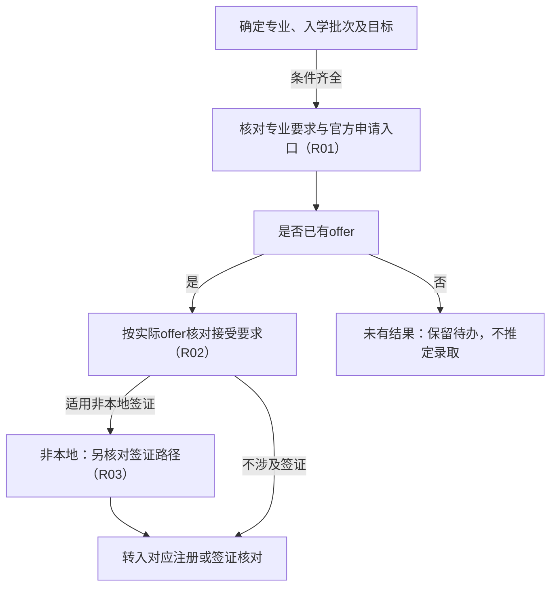
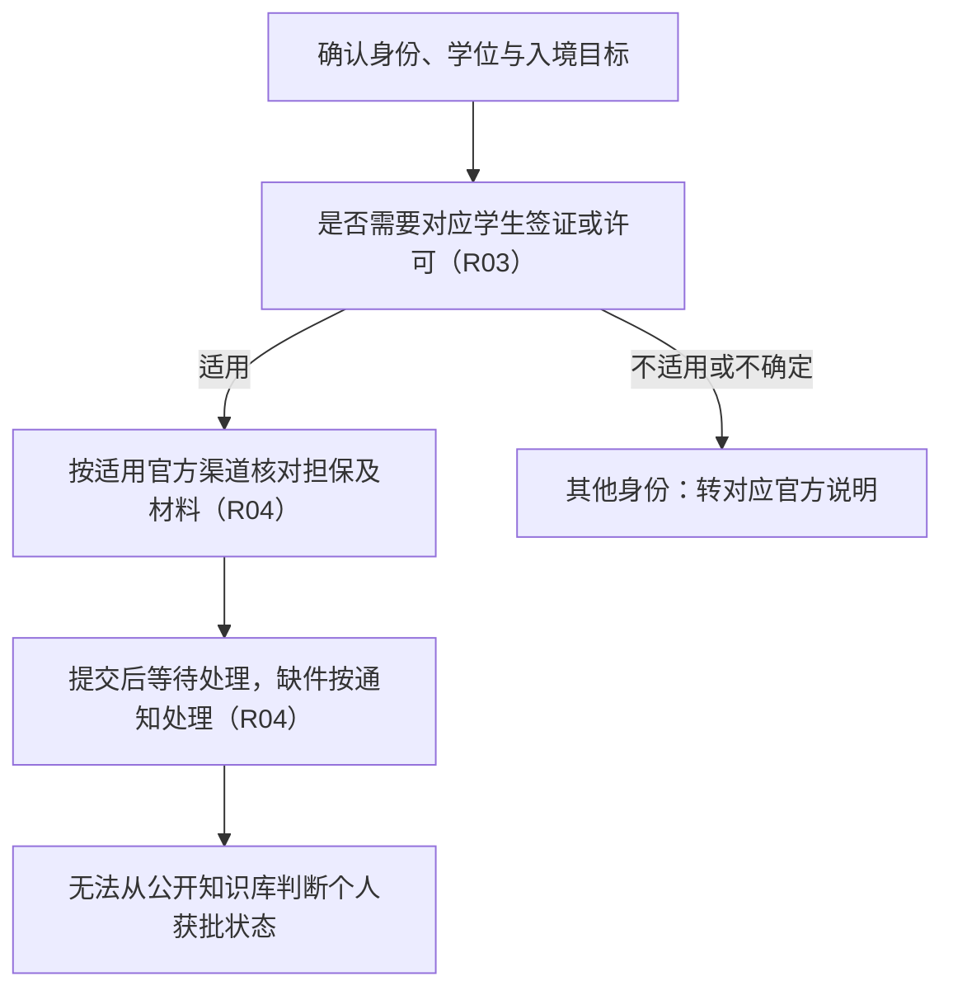
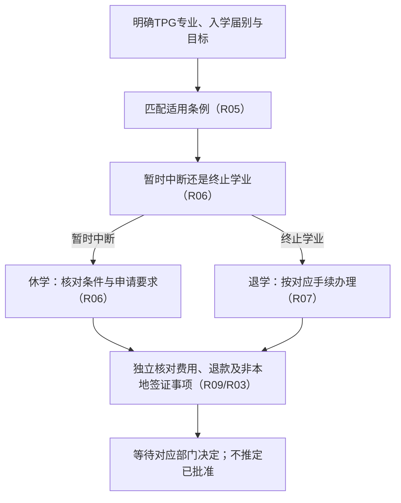
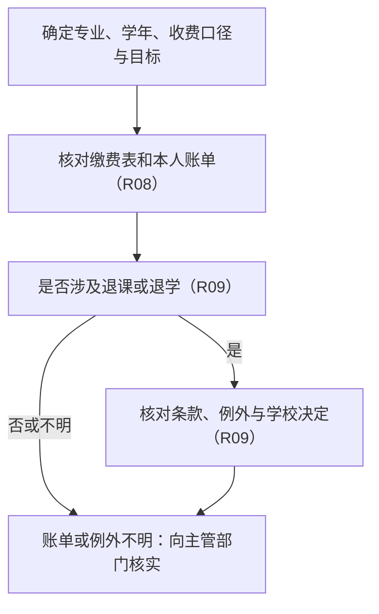
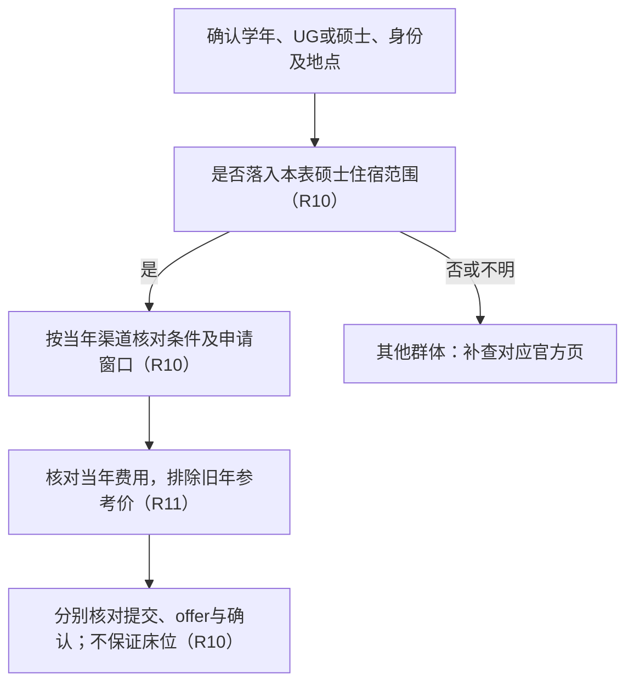
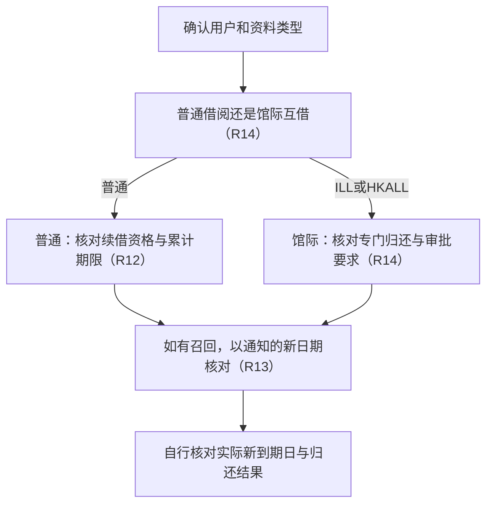
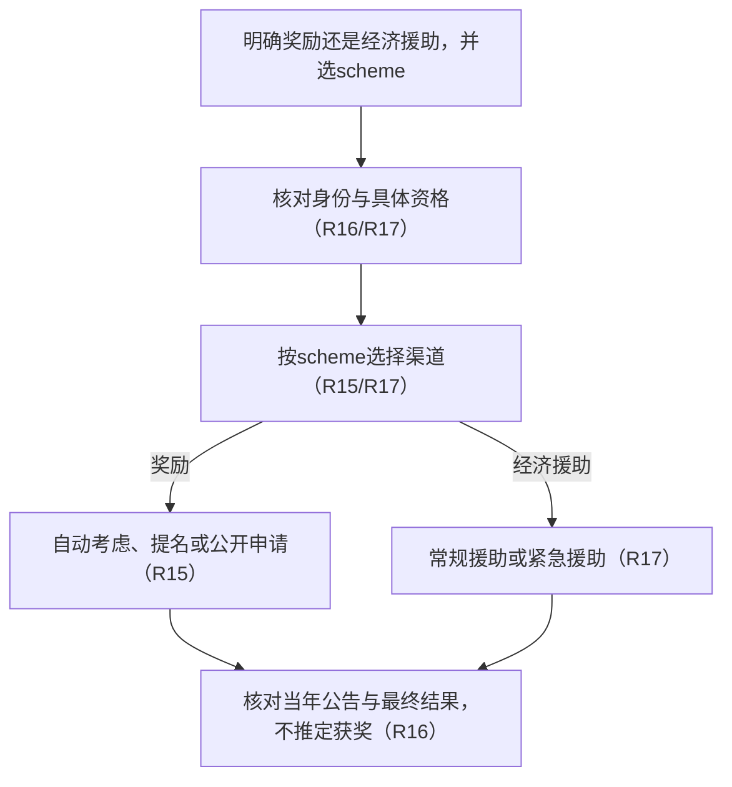
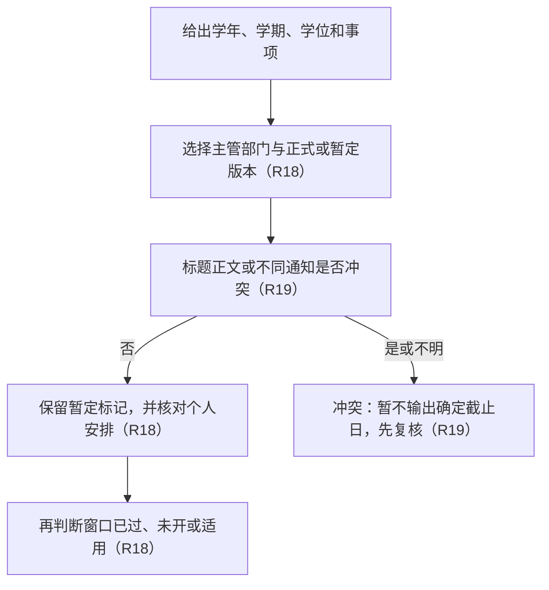

# 制度规则与目标流程：研究结论和维护入口

研究日期：2026-10-26，Asia/Shanghai。结论：采用现有官网正文库，加一个**按适用对象组织的规则目录和目标流程视图**。上层保留8个主题，优先做授课型硕士相关高频目标。本目录是研究候选，尚未形成获准使用的现行政策知识库。

## 对原方案的评价

“官网核真→分类规则→按目标画流程”适合本项目，比再造合成知识库更有价值。还需补足五件事：

1. 分类不能只有主题：另记学位、local状态、入学届别、当前学年、学期、收费口径、制度有效期；未知就保留未知，不能当作全部适用。
2. 保留原文及来源定位。摘要与流程都是派生解释，不能取代原文；条件、例外和例外审批不能在切块或归纳时消失。
3. 区分事实状态。官方URL、搜索索引、取得完整正文、适用性复核、人工批准是不同证据；HTTP 200也可能没有政策正文。
4. 把制度、操作步骤和个人状态分开。符合条件、提交申请、获批、缴款确认并不是同一个结果；公开知识库不能判断个人审批或欠款。
5. 流程节点引用规则ID并保留未解决分支。金额、日期、资格冲突时转人工核实，不能为了画出一条完整箭头而补造步骤。

| 方案 | 本项目的得失 | 判断 |
|---|---|---|
| 继续只检索整页网页 | 可追到原文，但跨页条件、届别和例外容易漏掉 | 保留为原文层及对照基线 |
| 只存分类摘要与流程图 | 易读，但来源更新后难找受影响结论，容易把归纳误当制度 | 不单独使用 |
| **原文＋来源登记＋原子规则＋目标流程** | 增量较小；规则、例外、来源和受影响流程可一同维护 | **本轮推荐** |
| 现在引入完整知识图谱或GraphRAG | 本轮问题首先是政策覆盖、适用范围和证据缺失；图谱仍需可靠抽取与审核 | 当前不作为启动依赖；有明确多实体关系需求再评估 |

规则表回答“哪些条件下适用什么规定”；流程图回答“为这个目标接下来核对或办理什么”。这与决策表和业务流程分工一致，可参考OMG的DMN/BPMN；目前用JSON和Mermaid表达即可，不必安装决策引擎。来源与派生关系参考W3C PROV的思路。以上是本项目设计判断，不是课程强制技术选型。

参考： [OMG DMN](https://www.omg.org/dmn/) · [W3C PROV](https://www.w3.org/TR/prov-overview/) · [GraphRAG索引说明](https://microsoft.github.io/graphrag/index/overview/)。

## 本地数据库说明了什么

两个agent分别完成只读数据库审计和4类官网研究；主agent补查申请、签证、学籍与费用，并整合方案。数据库以SQLite `mode=ro`读取，未查看个人问答日志，未导入、迁移或重建索引。范围为已定位的代表性快照和数据库，未遍历压缩包或穷尽全部历史副本。

| 已核实事项 | 对方案的影响 |
|---|---|
| 研究主候选159行、159个URL；另两份159行副本SHA相同 | 是同一份候选底稿；不能把副本数量当覆盖量。历史158行删签证实验不能冒充正式新快照 |
| 八主题计数：申请25、签证12、学籍18、宿舍24、费用13、奖助19、图书馆40、校历8 | 这是旧栏目归属，不是有效政策条目数量；内容需重新按规则与适用范围审视 |
| 集成库`records=83`，`documents=159`，活动159、dirty159、`chunks=0` | 研究应读活动文档快照；不能用旧records重导出，也不能据此宣布E5检索可运行 |
| 发布项目`data/`只有`.gitkeep` | 尚未接收真实运行知识库；本次没有静默复制旧快照到正式目录 |
| 119条`academic_year`为空；有`2026-2021`、`2025-2028`；一页正文2026/27但字段2020-2021 | 既不能自动填当前学年，也不能用不可靠元数据直接过滤。先核正文，必要时修②的字段提取 |
| 147条`date=crawled_at`；采集日期为2026-09-26至2026-10-11 | 不能把采集时间当制度生效日期；旧年也可能是制度实施起点，不能一律判失效 |
| SGS在159行中仅有`masters/nonlocal`；未找到硕士学术条例两个近似路径 | “注册与学籍18页”并不代表硕士条例已覆盖，需定向补页 |
| 71条有附件，共207个链接、94个独立PDF URL；未证实附件正文被解析 | 附件链接不等于可检索政策正文；官方流程图、细则PDF须另核内容和版本 |

研究快照SHA-256：`2c3f9a2d9dc116062791e8c646ad7e343fd8e22f5a59c91581f84808b0620752`。这是研究输入身份，**不是N2接收通过或政策现行有效的结论**。159行主快照与主库活动文档逐字段一致，但既有质检仍是`semantic_review=pending_member2`、`release_ready=false`。

## 官网核查的结果与边界

本次选16个官方来源入口，整理19条规则候选及8个目标流程；未声称穷尽官网。只有图书馆入门指南取得本轮完整可读正文；其余以官网搜索索引为主，部分直接访问403，接受offer的PDF只确认入口、未读图。对硕士条例的普通HTTP探针虽然返回200，却只有212字节、没有政策标题，未接受为政策正文。搜索索引更新时间也不等于制度生效时间。

主要发现：

- 学术条例须按入学届别及课程匹配；`regulation/acadreg`与`regulations/acadreg`不能仅凭近似URL合并。现有语料两个路径都未收录；本轮没有证实它们是同一版本，也没有凭URL断定其必然冲突。
- 休学、退学、退课和退费是不同事项。官方来源显示应分别核对，流程不能简化成“停止上课→自动退费”。
- 硕士住宿页面包含旧学年参考费用及不同渠道；不能把本科优先权、旧参考价或申请资格当作硕士当前收费与床位保证。
- 图书馆指南可确认累计续借上限与召回新日期；馆际互借还有专门规则，不能共用普通还书路径。
- 奖项可能自动考虑、提名或公开申请；经济援助另有身份及常规/紧急渠道，不存在面向所有学生的一条统一申请流程。
- 校历有暂定项；一份SGS选课通知的索引标题和正文学年不同，本次没有据此发布确定截止日期。

`catalog.json`逐来源记录访问层级和本地URL匹配情况。16个目标URL中7个能与研究快照按原路径及尾斜杠精确对齐；另9个没有作为该URL的独立正文记录匹配。这不是“9个页面确定未在任何位置出现”的结论，附件、重定向与别名仍需复核。路径大小写、singular/plural、双斜杠不擅自合并。

19条记录中，16条是官方内容的候选摘要，3条是研究者设定的版本/冲突核对规则，`kind`分别标记，不能把系统核对规则说成学校制度。所有记录保持`candidate`、无人工批准；当前流程是研究者整理的导航图，**不是学校发布的官方操作图或可执行审批流程**。官方已有的接受offer流程图应优先取得并核对，不让LLM重新猜一套。

## 轻量落地方式

唯一结构化底稿为[catalog.json](catalog.json)：`sources`登记来源与访问证据，`rules`保存原子规则与范围，`workflows`引用规则组织目标步骤。下方规则表和流程图由脚本生成，避免另维护一份摘要。现有12字段`corpus.jsonl`保持原契约；本目录不能直接交给③的`load_corpus`充当运行语料。

| 材料 | 用途与存放位置 | 与模型/评测的边界 |
|---|---|---|
| 原文知识库 | 组内接收的`data/corpus.jsonl`、数据库、附件正文与索引，绑定真实SHA | 检索依据；采集快照不自动等于现行政策核验通过 |
| 来源、规则和流程目录 | 本目录；当前研究候选，后续经复核才生成检索视图 | 只允许经批准且与原文绑定的派生内容进入运行知识库 |
| golden题集 | ④⑥根据已核实原文另做`evals/private/dev.jsonl`、`core.jsonl` | 问题以外的预期事实、动作、评分标签留在评测侧；不要把题集加入索引 |
| rubric | `evals/rubric.json`，规则见[评测入口](../evals/README.md) | 是通用判分标准，不是学校制度，也不是知识库正文 |

规则来源可与golden证据是同一篇官网，这是RAG应能检到的知识；禁止的是把测试题、标准答案与判分标签作为知识塞入。比较RAG与Agentic RAG时共享同一语料和规则视图；若加入人工规则整理，分别报告整理前后结果，不把知识库增强收益都算给Agent编排。

执行顺序：

1. ②先核正文、缺页与附件，修复明显错误学年；①确认接收的快照身份。优先补硕士条例、休学/退学、硕士住宿、图书馆借阅细则等政策页，不重爬整站。
2. 对每个目标核对身份、届别、当前学年与例外。Agent只负责发现、提取候选与标冲突，②和相应评测复核者独立读官方原文；证据不足保持candidate。
3. 记录完整原文快照SHA、定位、短证据、审核岗位与日期。来源更新时回查受影响规则和流程；旧版不静默覆盖。来源权威性、适用范围、生效时间共同判断，不能机械认为某一类页面永远覆盖所有其他页面。
4. ③保全条件与例外并形成可检索视图；⑤按目标选可能涉及的多个主题，缺少关键条件先澄清，不能只用单个硬主题过滤漏掉费用/签证后果。流程图目前只做导航，不自动提交、付款或操作账户。
5. ④做证据覆盖与检索统计，⑥做必要事实、预期动作及回答/引用评分，共用ID和来源；再冻结真实DEV/CORE20。规则审核和golden复核分开，不让系统自己给自己生成与验收标准。

先验证本目录结构和视图同步：

```powershell
python -m scripts.check_policy_assets
# 修改catalog后重新生成下方视图
python -m scripts.check_policy_assets --render
# 当前预期失败：本目录尚未通过真实来源与人工批准关口
python -m scripts.check_policy_assets --require-ready --corpus data/corpus.jsonl
```

程序只查结构、引用、来源域名、版本及人工记录条件；不能证明解释正确或审核实际发生。本轮未改生产数据库、运行Agent抓取、生成正式golden或宣称四模式已实现。新目录不含个人审批、聊天、账号或密钥；原文全文及详细审计留忽略目录。页面摘要也需按学校使用条件和引用范围复核后再公开。

<!-- GENERATED POLICY VIEWS: edit catalog.json, then run scripts.check_policy_assets --render -->

## 分类制度与规则表（19条）

本版规则状态均为研究候选；后续状态以catalog记录为准。英文statement见catalog，表内保留适用条件与例外。

| 规则／主题 | 内容与适用对象 | 限制、例外及来源 |
|---|---|---|
| R01／申请（官网候选摘要） | 申请入口与专业要求分开核对；申请授课型硕士 | 不要把一个专业的截止日当全校共同日期。 来源：S01 |
| R02／申请、学费与缴费（官网候选摘要） | 按offer确认接受要求；已经收到相应offer的TPG申请人 | 官方已有接受offer流程图入口，但图中步骤本轮未取得；不自行补造固定金额、时限或按钮。 来源：S01 |
| R03／签证与国际学生服务、申请（官网候选摘要） | 录取与签证审批分开；需要学生签证/入境许可的非本地申请人 | 按身份与课程类别选SGS/ADMO相关通道；不访问个人审批账户。 来源：S03, S04 |
| R04／签证与国际学生服务（官网候选摘要） | 办理周期不构成获批承诺；适用签证担保流程的申请人 | 处理周期、建议提前量、材料补交与个人结果是不同字段；不生成必批或具体到期承诺。 来源：S03, S04 |
| R05／注册与学籍（官网候选摘要） | 先匹配入学届别的条例；TPG；PCLL及不同入学届别须另核对 | 入学届别、当前学年、规则生效日期不能混为一个academic_year字段。 来源：S05 |
| R06／注册与学籍、学费与缴费、签证与国际学生服务（官网候选摘要） | 休学与退学分流；TPG，个人状态与条件需补齐 | 流程只提供核对路径；不默认休学批准、无限延期或学费豁免。 来源：S06, S07 |
| R07／注册与学籍、学费与缴费（官网候选摘要） | 停止上课不代表手续完成；需要退学的TPG | 申请、学校处理结果、课程状态及退款是不同结果；不替学生提交申请。 来源：S07, S08 |
| R08／学费与缴费（官网候选摘要） | 按对应缴费表与个人账单核对；TPG；当前学年和收费口径必须明确 | 不从公开政策推定个人欠款；不使用研究快照中的错误academic_year元数据。 来源：S09 |
| R09／学费与缴费、注册与学籍（官网候选摘要） | 退课退学与退款分别判断；TPG；须看课程及获准例外 | 须核对适用条款、例外及学校决定；不概括成所有情况一律不退。 来源：S07, S08 |
| R10／宿舍（官网候选摘要） | 硕士住宿渠道及结果分开；2026/27全日制硕士；具体课程仍待确认 | 不能套用UG首年/首两年优先权；普通与共享单位渠道、地点及确认阶段分开。 来源：S10 |
| R11／宿舍、学费与缴费（研究核对规则） | 旧年参考住宿费不能作现价；需要核对2026/27硕士住宿费用者 | 来源页面列有2025/26参考信息；没有据此计算2026/27应付金额，申请窗口也需重查。 来源：S10 |
| R12／图书馆（官网候选摘要） | 多次续借受累计期限限制；图书馆可续借资料；按用户及资料类别核对 | 不把unlimited number of renewals解读为无限借期；具体天数不在本草案转录。 来源：S11 |
| R13／图书馆（官网候选摘要） | 召回新日期覆盖原日期；收到资料召回通知的借阅者 | 个人实际到期日须由用户自行查通知/账户；系统不索取账号密码或OTP。 来源：S11 |
| R14／图书馆（官网候选摘要） | 馆际互借按专门规则归还续借；ILL/HKALL或海外馆资料借阅者 | 不套用普通还书箱或普通续借流程；具体材料类别和审批结果待查。 来源：S12 |
| R15／奖学金与助学金（官网候选摘要） | 奖项渠道并不统一；已选定具体奖项的学生 | 概述中的无须另行申请仅适用于对应奖项类型；不得推广至所有奖助学金。 来源：S13 |
| R16／奖学金与助学金（官网候选摘要） | 资格按具体奖项逐项判断；须明确学位、年级、local状态及资助类别 | UG、local或非毕业年专属条件不能扩展到非本地TPG；提名不等于获奖。 来源：S13 |
| R17／奖学金与助学金（官网候选摘要） | 常规经济援助与紧急援助分流；以所选scheme列出的身份为限 | 概述的full-time local条件不证明非本地TPG适用；惯常月份不是当年开放证明。 来源：S14 |
| R18／校历与重要日期、注册与学籍（研究核对规则） | 日期须匹配学年学期与主管部门；查询某一具体手续日期者 | 区分正式、暂定、历史安排及个人time-ticket；不能以索引抓取时间当生效时间。 来源：S15, S16 |
| R19／校历与重要日期、注册与学籍（研究核对规则） | 冲突或已过窗口须停下复核；查询选课及手续窗口者 | S16标题与正文有学年冲突；本草案不发布具体截止日或宣称窗口仍开放。 来源：S16 |

## 八个目标流程（研究导航图）

各图以条件已补齐为前提；条件缺失先澄清。节点中的R编号回查上表，跨主题流程不是单一栏目的顺序清单。

### F01 申请TPG并处理录取通知



### F02 准备学生签证与入境许可



### F03 决定休学还是退学，并核对后果



### F04 核对缴费或退费



### F05 找适用住宿渠道并判断申请阶段



### F06 续借、召回与归还资料



### F07 找奖学金或经济援助渠道



### F08 确定某项手续的有效日期



## 官方来源登记与核实状态

A＝本轮完整正文可读；B＝官网索引支持；L＝仅确认入口。均不自动代表现行有效或人工批准。

| ID／来源 | 层级及实时结果 | 研究快照对齐 | 定位与待核事项 |
|---|---|---|---|
| [S01 TPG: Steps for Applying](https://www.cityu.edu.hk/pg/taught-postgraduate-programmes/steps-applying) | B／not_confirmed | 未按该URL对齐 | Submission of Applications / acceptance；官网索引支持网上申请入口；各专业及offer具体条件仍需逐项核对。 |
| [S02 Flow Chart for Accepting Offers of Master's Programmes](https://www.cityu.edu.hk/sgs/files/prospective/tpg/faq/flow_chart_for_accepting_offers_of_master%27s_progs.pdf) | L／http_403 | 未按该URL对齐 | official PDF flow chart；仅确认官方流程图入口；PDF正文实时403，未读图，不据此转录具体操作。 |
| [S03 Student Visa: Postgraduate](https://www.cityu.edu.hk/sgs/student/masters/visa) | B／not_confirmed | 未按该URL对齐 | student visa / sponsorship / supporting documents；官网索引支持非本地硕士签证手续；个人审批结果与现行完整材料清单未取得。 |
| [S04 Student Visa / Entry Permit](https://www.cityu.edu.hk/admo/non-local-students/visa/student-visa) | B／http_403 | 独立正文第22行 | visa/entry permit sponsorship；本地旧快照与官网索引均有对应内容；处理周期不等于建议提前量，更不构成获批承诺。 |
| [S05 Academic Regulations for Taught Postgraduate Degrees](https://www.cityu.edu.hk/sgs/student/masters/regulation/acadreg) | B／body_not_policy | 未按该URL对齐 | applicability header / cohort-specific regulation links；索引显示按入学届别与PCLL分流；近似的regulations/acadreg路径不能凭URL外观视为同一版本。直接HTTP探针200但只有212字节，无政策标题，未接受为正文。 |
| [S06 Leave of Absence](https://www.cityu.edu.hk/sgs/student/masters/records/leave) | B／http_403 | 未按该URL对齐 | eligibility / application / study period；休学属于学籍安排，不能与withdrawal混用；最长期限及当前提交节点待完整正文复核。 |
| [S07 Withdrawal of Studies](https://www.cityu.edu.hk/sgs/student/masters/records/withdrawal/) | B／http_403 | 未按该URL对齐 | Application / Tuition Fees / consequence；索引支持须按申请渠道办理、学费后果另核对。没有把停课当成手续已完成。 |
| [S08 Tuition and Other Fees: Taught Postgraduate](https://www.cityu.edu.hk/fo/htm/TPg_Fees.htm) | B／http_403 | 独立正文第39行 | Withdrawal of Studies / refund exceptions；需要区分退课、退学、退费以及全校或课程例外；不生成一律可退或一律不退的规则。 |
| [S09 Payment Schedule: Taught Postgraduate](https://www.cityu.edu.hk/fo/htm/TPg_PaySchedule.htm) | B／not_confirmed | 独立正文第40行 | Payment Schedule / e-statement；研究快照正文含2026/27，而旧academic_year字段为2020-2021；按正文与本人账单复核，不能信任旧字段。 |
| [S10 Full-time Master's Degree Students in 2026/27: Housing](https://www.cityu.edu.hk/sro/StudentHousing/PGHalls/Master%27sDegreeStudent.htm) | B／http_403 | 未按该URL对齐 | application channels / Important Notes / fee reference；官网索引区分普通与共享单位渠道，获批机会有限；MOS出现2025/26参考费用，不能写成2026/27现价。 |
| [S11 Library: Get Started](https://libguides.library.cityu.edu.hk/start) | A／full_text_read | 独立正文第86行 | Borrow Materials / Renewals / Recalls；web.open已读完整官方指南；确认累计续借上限与召回新日期，但仍未形成绑定本地快照的人工批准规则。 |
| [S12 Interlibrary Loans: Returns, Renewals and Recalls](https://www.cityu.edu.hk/lib/service/InterlibraryLoan/ReturnsRenewals.htm) | B／http_403 | 未按该URL对齐 | Returning Physical Books / Renewing Physical Book Loans；馆际互借归还渠道、海外馆续借审批不能套普通借阅；实时正文403。 |
| [S13 Scholarships / Prizes at a glance](https://www.cityu.edu.hk/sds/student-life-resources/student-finance/scholarships/scholarships-prizes-at-a-glance) | B／http_403 | 独立正文第141行 | entrance / academic / non-academic awards；官方索引支持自动考虑、提名与公开申请等不同渠道；奖项身份和年份须逐项核对。 |
| [S14 Overview on Financial Assistance](https://www.cityu.edu.hk/sds/student-life-resources/student-finance/financial-assistance/overview-on-financial-assistance) | B／http_403 | 独立正文第136行 | University Bursaries and Loans / Emergency Assistance；概述的经济援助面向所列身份；常规援助与紧急援助分流，不据此推定所有非本地TPG符合资格。 |
| [S15 Important Dates](https://www.cityu.edu.hk/arro/impd/impd_year.htm) | B／http_403 | 独立正文第33行 | academic year / semester / tentative event dates；跨多个学期且有暂定项目；ARRO日期不能直接替代所有SGS硕士手续日期。 |
| [S16 Postgraduate Course Registration: Important Notice](https://www.cityu.edu.hk/sgs/student/masters/coursereg//importantnotice) | B／http_403 | 未按该URL对齐 | academic year / deadline for all add-drops；搜索标题2025/26、正文2026/27存在冲突；保留原双斜杠URL，未判定现行截止日。 |
